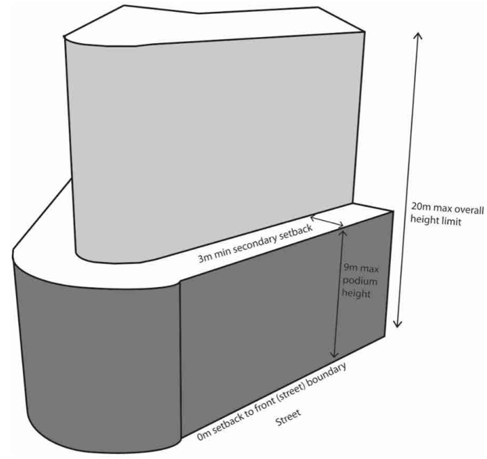

### 3.5 Area Based Controls – Local and Neighbourhood Centres

#### Secondary Setbacks Objectives

O1 To establish the spatial proportions and enhance the urban qualities of the street.

O2 To facilitate higher density development while maintaining the existing character of street development.

#### Provisions

P1 Where development exceeds 9m in height, the part of the development above 9m must be set back a minimum of 3m from the street front boundary.

P2 Setback areas must be free of any projections or encroachments.

#### Advisory Note:

Figure 44 shows street front and secondary setbacks and podium heights in the Croydon Park and Enfield Local

> [Picture on page 82: a picture, saved as a picture (images/section-03-development-in-centres-and-corridors-page-82-13.gif, 150 dpi).]

Centres.

Figure 44. Setbacks and Height Limits in the Enfield and Croydon Park Local Centres

#### Side and Rear Setbacks Objectives

O1 To define the urban form of development.

O2 To minimise the amenity impact of development on adjoining properties.
