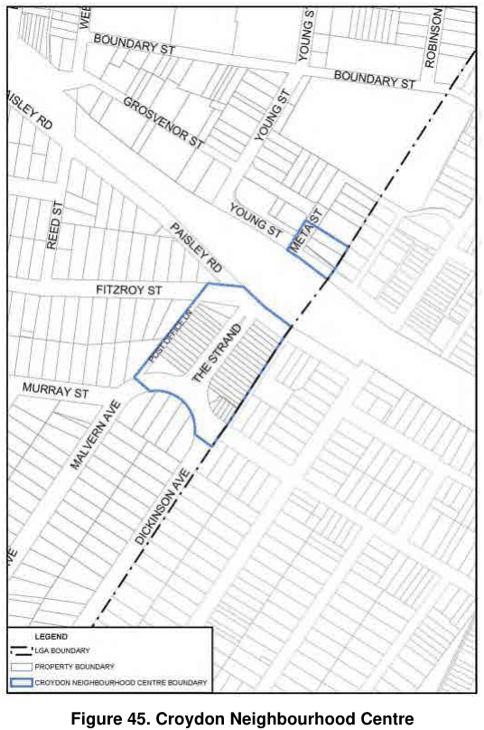

### 3.5 Area Based Controls – Local and Neighbourhood Centres

> [Picture on page 85: a picture, saved as a picture (images/section-03-development-in-centres-and-corridors-page-85-2.gif, 150 dpi).]

#### Figure 45. Croydon Neighbourhood Centre

#### Controls for Croydon Neighbourhood Centre Building Form Objectives

O1 To maintain the character and streetscape of the area through the conservation and enhancement of existing buildings, structures and work.

O2 To facilitate infill development while maintaining the existing character of the street.

#### Provisions

P1 Development at the rear of sites should not be visible from The Strand and must complement the existing building.

P2 Street front development will only be permitted in certain circumstances (repair, replacement) and must enhance the existing streetscape and be of a similar scale, grain, form, bulk, placement and character to adjoining and nearby street front development.

P3 Continuous awnings that match the building design and are complementary to adjoining development must be provided.
