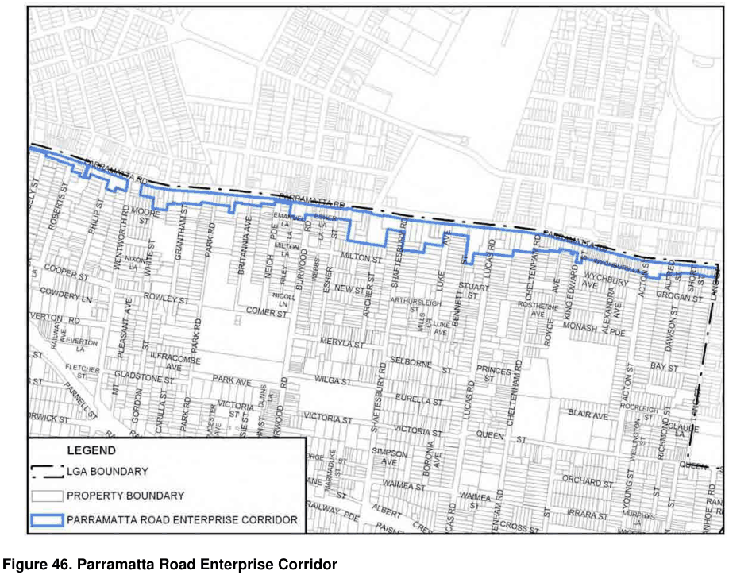

### 3.6 Area Based Controls – Parramatta Road Enterprise Corridor

> [Picture on page 88: a picture, saved as a picture (images/section-03-development-in-centres-and-corridors-page-88-2.gif, 150 dpi).]

#### Figure 46. Parramatta Road Enterprise Corridor

#### Aims

The aims for this DCP section are:

To support change and improvement in the character and quality of the corridor, its land uses, amenity and local environment.

To ensure that the impacts of land uses are contained within the corridor with no or minimal overflow to adjoining residential areas.

To provide appropriate protection through the design and location of buildings in the corridor to the amenity, solar access and privacy of adjoining low density residential land to the south.

To encourage an active street character through building setbacks, location and design, the inclusion of residential development and the location of parking underground or behind buildings.

#### Parramatta Road Street Front Setbacks Objectives

O1 To establish the relationship of buildings to the street.

O2 To encourage an active street character.

O3 To provide space for landscaping and improve local amenity.
