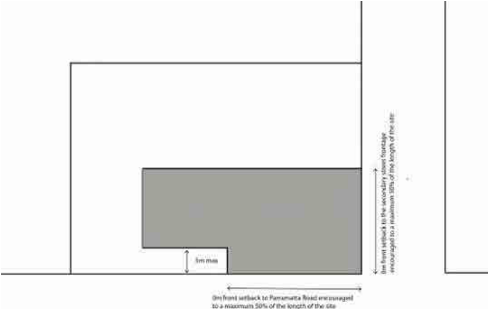

### 3.6 Area Based Controls – Parramatta Road Enterprise Corridor

P2 Where a building exceeds 8m in height on a side street frontage, that part of the building above 8m must have a secondary setback of a minimum of 3m from the side street boundary.

P3 Setback areas at ground level must be free of any encroachment or projection from any building with the exception of approved awning structures including shade sails that provide weather and sun protection.

P4 Setback areas must include landscaping that improves the amenity of the site and the street frontage, and paving that facilitates pedestrian access to activities on the site. Primary setback areas cannot be used for the provision of car parking.

P5 In the case of vehicle sale or hire premises only, the side street primary setback area may be used for the display of vehicles provided high quality fencing, vehicular access and parking, and clear pedestrian access are included in the development.

P6 Buildings on corner sites are to be articulated to address each street frontage and are to define prominent corners.

> [Picture on page 90: a picture, saved as a picture (images/section-03-development-in-centres-and-corridors-page-90-16.gif, 150 dpi).]

#### Figure 47. Parramatta Road Street Front and Side Street Setbacks

#### Side and Rear Boundary Setbacks

These provisions apply to sites with boundaries that immediately adjoin another property or a laneway.

#### Objectives

O1 To define the urban form of development.

O2 To limit building heights to facilitate adequate solar access to land adjoining the B6 zone.

O3 To mitigate any adverse effects on the amenity of existing and future residents living adjacent to the B6 zone.
