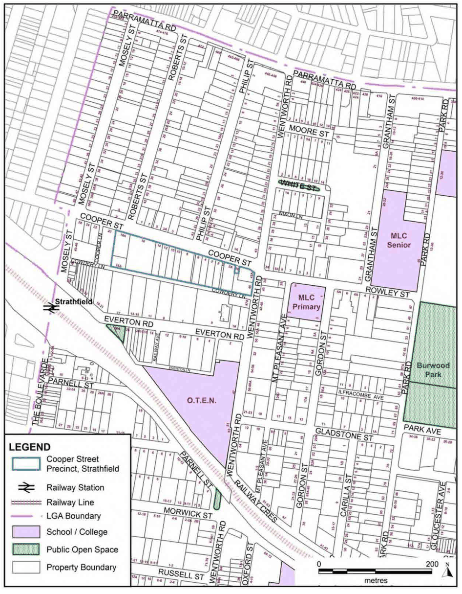

### 3.7 Area Based Controls – Cooper Street Precinct, Strathfield

### 3.7 Area Based Controls – Cooper Street Precinct, Strathfield

#### Introduction

This section applies to development on properties outlined in Figure 48.

> [Picture on page 92: a picture, saved as a picture (images/section-03-development-in-centres-and-corridors-page-92-5.gif, 150 dpi).]

#### Figure 48. Cooper Street Precinct, Strathfield
