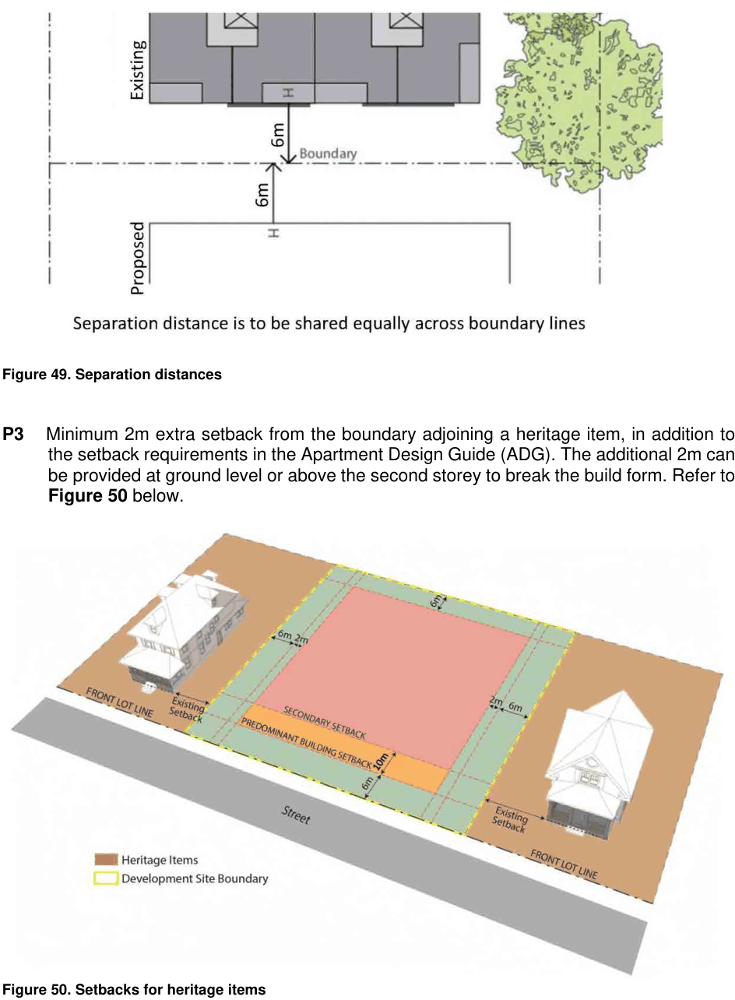

### 3.7 Area Based Controls – Cooper Street Precinct, Strathfield

> [Picture on page 96: a picture, saved as a picture (images/section-03-development-in-centres-and-corridors-page-96-2.gif, 150 dpi).]

#### Figure 49. Separation distances

P3  Minimum 2m extra setback from the boundary adjoining a heritage item, in addition to the setback requirements in the Apartment Design Guide (ADG). The additional 2m can be provided at ground level or above the second storey to break the build form. Refer to Figure 50 below.

#### Figure 50. Setbacks for heritage items

P4 The minimum separation distance to all facades of a heritage item within the same site or an amalgamated site is 6m.
