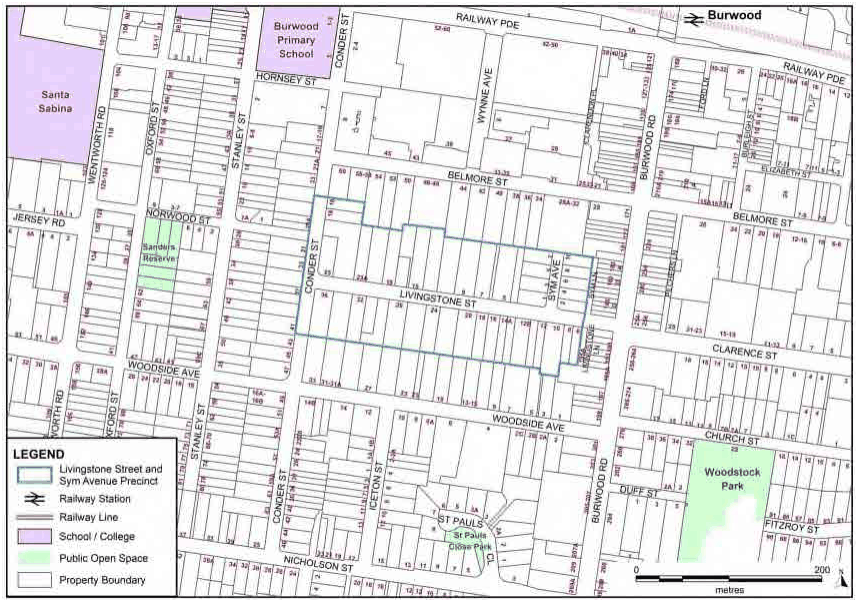
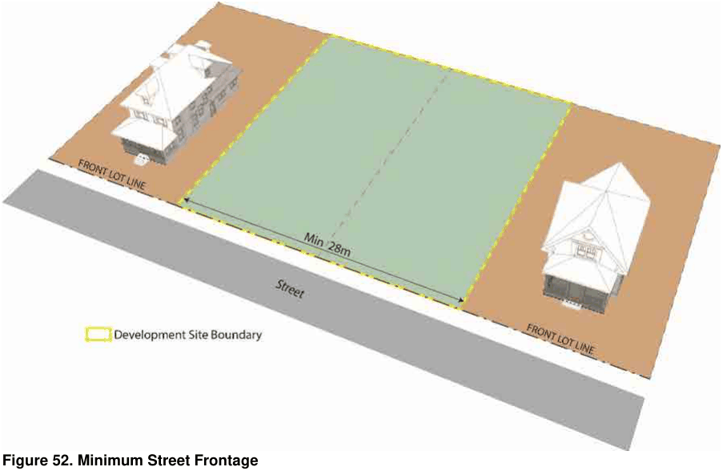
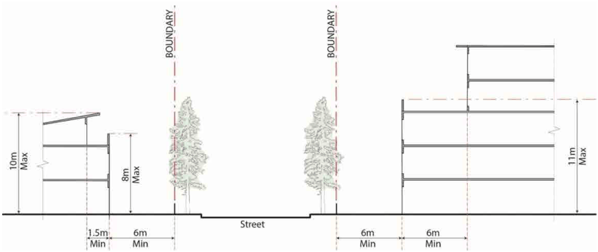
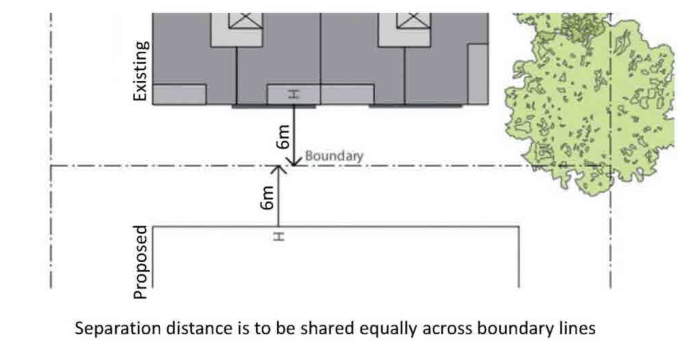
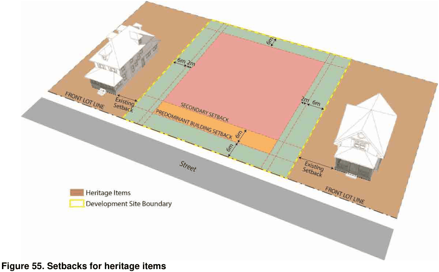

### 3.8 Area Based Controls – Livingstone Street and Sym Avenue Precinct, Burwood

#### Introduction

This section applies to development on properties outlined in the figure below:

> [Picture on page 99: a picture, saved as a picture (images/section-03-development-in-centres-and-corridors-page-99-6.gif, 150 dpi).]

#### Figure 51. Livingstone Street and Sym Avenue Precinct

#### Overview

The Burwood Livingstone Street and Sym Avenue Precinct is located in close proximity to the Burwood Town Centre and the public transport node of Burwood Railway Station and bus linkages.

The subject Precinct is:

less than a 400 metre walk from Burwood Railway Station adjacent to the southern boundary of the Burwood Town Centre close to retail and commercial premises close to education, health and recreational facilities

Council prepared a Planning Proposal to rezone the Precinct from R2 Low Density Residential to partly R1 General Residential and partly R3 Medium Density Residential, in order to increase the housing supply. The Department of Planning, Industry and Environment has issued a Gateway Determination for this Planning Proposal.

Please refer to parts 4-8 of this DCP for guidance relating to different forms of development and design considerations. In addition, the following objectives and provisions relate specifically to the Livingstone Street and Sym Avenue Precinct. These provisions take precedence when applied to the subject Precinct, if they differ to other parts of the DCP.

3.8 Area Based Controls – Livingstone Street and Sym Avenue Precinct, Burwood

Site Planning and Response to Character

#### Objectives

O1 To encourage the efficient use of land.

O2 To establish appropriate development controls that increase housing supply and diversity.

O3 To balance increased density with heritage conservation values as a key consideration.

O4 To promote ‘human scale’ and enhance the pedestrian environment of Livingstone Street, Sym Avenue and Sym Lane.

#### Provisions

P1 Any proposed development will need to preserve and not detract from the heritage and conservation values of the heritage items within and/or in close proximity to the Precinct.

P2  Proposed massing and overall built form will need to respond to the character of the heritage items within the Precinct.

P3  Proposed massing and overall built form will need to be designed and articulated in a way that ensures a ‘human scale’ when visible from Livingstone Street, Sym Avenue and Sym Lane.

P4 Development consent shall not be issued unless the applicant has clearly demonstrated that the proposal has considered and responded to:

the surrounding context of the precinct, the area’s contributory elements (physical and environmental). the heritage values of the heritage items within and surrounding the precinct

Height of Building and Floor Space Ratio

P1 The development standards in the BLEP 2012 apply.

Site Coverage

#### Objectives

O1 To provide for adequate landscape and deep soil areas.

O2 To adequately mitigate the effects of bulk, scale and overall massing.

O3  To establish appropriate footprints and areas for basement and parking.

#### Provisions

P1 The footprint of proposed buildings must not to occupy more than 70% of the site.

P2 The footprint of basement levels should stay within the outline of the building/s above ground and not protrude into any setbacks.

3.8 Area Based Controls – Livingstone Street and Sym Avenue Precinct, Burwood

Street Frontage

#### Objectives

O1 To ensure the orderly development of all sites including sites containing or adjacent to heritage items.

O2 To present building frontages within generously landscaped separation distances.

O3  To establish appropriate footprints that can accommodate vehicle entries within the building footprint.

#### Provisions

P1 The street frontage of any development fronting Livingstone Street  and/or Sym Avenue shall comply with Figure 52 below and the Minimum Site Frontage provisions stipulated in the BLEP 2012.

> [Picture on page 101: a picture, saved as a picture (images/section-03-development-in-centres-and-corridors-page-101-13.gif, 150 dpi).]

Figure 52. Minimum Street Frontage

Street Wall Heights

#### Objectives

O1 To ensure that the scale of the built form promotes a ‘human scale’ facing all frontages visible from the public domain.

O2 To ensure an adequate ‘sense of enclosure’ and improve pedestrian experience along Sym Lane.

#### Provisions

P1 The street wall height of any development fronting Livingstone Street and/or Sym Avenue shall comply with Figure 53 below and the relevant provisions stipulated in the BLEP 2012.

3.8 Area Based Controls – Livingstone Street and Sym Avenue Precinct, Burwood

> [Picture on page 102: a picture, saved as a picture (images/section-03-development-in-centres-and-corridors-page-102-2.gif, 150 dpi).]

Figure 53. Livingstone Street, Street Wall Height and Primary and Secondary Setbacks

P2 The street wall height of development fronting Sym Lane shall be no more than 13.5m inclusive of parapets.

Setbacks

#### Objectives

O1 To ensure the street setback enhances the setting of the building, and that side and rear setbacks create usable land and maintain amenity between neighbouring sites.

O2 To ensure that the built form improves the landscape character, encourages landscape screening and contributes to the landscape softening of Livingstone Street, Sym Avenue and areas adjacent to common boundaries.

O3 To ensure deep soil areas contribute to the provision of mature planting and water filtration to all setbacks.

O4 To ensure adequate separation distances to protect the curtilage and buildings of heritage items.

#### Provisions

Primary Setbacks

P1 Primary setbacks to Livingstone Street and/or Sym Avenue shall comply with the relevant provisions stipulated in the Planning Proposal, which is expected to result in a LEP clause in the BLEP 2012.

P2 Ground level setback to Livingstone Street, Sym Avenue and/or Sym Lane should be occupied by a combination of private courtyards and communal space. Private courtyards can occupy up to 3 metres from the building line with the reminding distance up to the boundary to be maintained by the strata management to achieve a consistent treatment and upkeep.

P3 Private courtyards to be enclosed by fencing with openable gates. Fencing can have a solid base up 600mm with picket / railing style fence with a minimum of 1.2 up to 1.5m including the solid base. If additional privacy is required above 1.5m, this can be achieved with the use of shrubs or hedging. Picket / railing style fencing must have at least 50% transparency.

3.8 Area Based Controls – Livingstone Street and Sym Avenue Precinct, Burwood

P4 The setback to Sym Lane can be occupied by a private courtyard up to 3m from the building façade and be enclosed by a picket / railing style fence up to 1.2 m. The reminding distance between the kerb and the fence should be utilised as a deep landscaping planting to be maintained by the strata management.

P5 Fences facing Sym Lane are to be permeable with a minimum 40% with operable gates leading to private courtyards at ground level for activation and convenient rear access.

Secondary Setbacks

P1 Secondary setbacks to Livingstone Street and Sym Avenue above the street wall height shall comply with Figure 53 and the relevant provisions stipulated in the BLEP 2012.

P2 Secondary setbacks to Sym Lane above the street wall height shall be a minimum of 3m.

Side Setbacks and Separation Distances

P1 Side setbacks and separation distances are to comply with the Apartment Design Guide design criteria 1 under Objective 3F-1.

P2 Separation distances are to be shared equally by both properties to either side of the common boundary. Refer to the image below.

> [Picture on page 103: a picture, saved as a picture (images/section-03-development-in-centres-and-corridors-page-103-17.gif, 150 dpi).]

#### Figure 54. Separation distances

P3 The separation distance to a site containing a heritage item shall comply with Figure 55 below and the relevant provisions stipulated in the BLEP 2012. The additional 2m can be provided at ground level or above the second storey to break the build form. Refer to the image below.

3.8 Area Based Controls – Livingstone Street and Sym Avenue Precinct, Burwood

> [Picture on page 104: a picture, saved as a picture (images/section-03-development-in-centres-and-corridors-page-104-2.gif, 150 dpi).]

#### Figure 55. Setbacks for heritage items

P4 The minimum separation distance to all facades of a heritage item within the same site or an amalgamated site is 6m.

18 Conder Street, Burwood

#### Objectives

O1 To mitigate the impacts of the partial removal of the Building Height Plane (BHP) Line E next to No. 18 Conder Street.

O2 To protect the amenity of residential uses to the south of No. 18 Conder Street.

#### Provisions

P1 Side setback to southern boundary to be at least 6m at ground level up to 12m and comply with ADG separation distances.

P2 Southern elevation facing common boundary with 23 Livingstone Street, Burwood must be articulated and display habitable windows. Recesses or built form features are required at 10-12m intervals.

P3 Side setback at ground level is for the purpose of greening and mature landscaping to provide landscape buffer to the properties to the south of the common boundary.

Landscaping and Open Space

#### Objectives

O1 To maximise the use and provision of communal open space at ground level.

3.8 Area Based Controls – Livingstone Street and Sym Avenue Precinct, Burwood

O2 To ensure high quality landscaped grounds that contribute to the overall character of the area.

#### Provisions

P1 The minimum landscaped area shall comply with the relevant provisions stipulated in the BLEP 2012.

P2 Communal open space is preferred at ground level and associated with deep soil areas and provided with shade and amenities i.e. water tap, BBQ and seating.

P3 Areas and dimensions for communal open space and landscaping are to comply with the Apartment Design Guide sections 3D and 3E.

Built Form

#### Objectives

O1 To ensure that the built form and massing contribute to the creation of character and display design excellence through well-articulated elevations, interesting roof forms and high quality materiality.

#### Provisions

P1 All elevations should display design excellence and generally comply with provisions P28 and P29 under Section 3.2.1 Building Design of the DCP.

P2 Elevations facing Livingstone Street and/or Sym Avenue need to display ‘fine grain’ articulation or recesses running vertically the full height of the applicable street wall height or parapet.

P3 A maximum length of uninterrupted building frontage of 10m for terrace or townhouse development on the southern side of Livingstone Street in order to achieve substantial articulation in the form of an indent, recess or physical break along the length of the elevation.

P4 Side elevations need to display a combination of indents, architectural fenestration and habitable windows. Unarticulated blank facades that can be characterised as non-habitable walls are not permitted.

P5 Recesses (min. 2m X 2m) need to be placed on side elevations every 10-12m depending on the length of the elevation.

Vehicle Entries, Servicing and Waste Management

#### Objectives

O1 To minimise potential pedestrian-vehicles conflicts along Livingstone Street and Sym Avenue.

O1 To minimise visual impacts to both sides of Livingstone Street, the western side of Sym Avenue and Sym Lane through the orderly provision of waste management and bin collection areas within the site.

3.8 Area Based Controls – Livingstone Street and Sym Avenue Precinct, Burwood

#### Provisions

P1 All access for private or service vehicles to be integrated with the overall building design. Any visible areas from the public domain in front or behind the security grille to be treated with high quality materials as the main façade.

P2 Bin enclosure areas need to be located within the building envelope, be accessible from the vehicle driveway and be integrated within the architectural design of the building.

P3 Road side collection and bin enclosures visible from the public domain or located within the landscape setbacks are not permitted.

Mailbox and Postal Facilities

P1 Mail box and postal facilities to be included and to comply with provisions P8, P9 and

P10 under Section 3.2.4 Street-Front Activities and Building Access. Refer to Figure 1 and Figure 2.

Fire Safety and Power Supply Utilities

P1 Fire safety and power supply utilities are to comply with provision P12 under Section

3.2.4 Street-Front Activities and Building Access. Refer to Figure 3.

Mechanical and Ventilation Equipment

P1  Mechanical and Ventilation Equipment are to comply with Provisions 15, 16, 17, 18 under Section 3.2.4 Street-Front Activities and Building Access.
