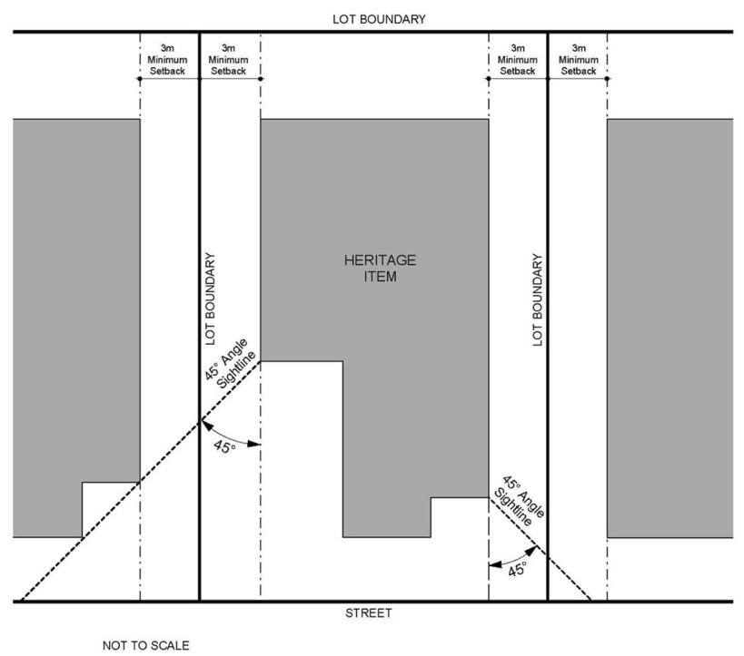

### 3.10 Heritage in Centres and Corridors

#### Incorporating Heritage Items into New Development

P10 Where a larger development proposes to incorporate a heritage item or significant place, the design must include appropriate measures to:

Retain an appropriate setting to allow for the continued appreciation and integrity of the heritage item. Ensure the heritage item is not visually obscured or adversely altered, particularly regarding sight lines from the public domain.

P11 Where a development involves subdivision, Council will generally require that repair or restorative work to the heritage property is undertaken prior to the subdivision. This approach seeks to ensure that the conservation of the heritage property is integral to the redevelopment.

#### Sight Lines

P12 Development adjacent to a heritage property must incorporate front and/or side setbacks to achieve sight lines to the significant building in accordance with Figure 56. More generous setbacks may be required to achieve views and vistas. Refer to P13 in the following section for further details. The front alignment of a new development must be sympathetic to the heritage property.

> [Picture on page 129: a picture, saved as a picture (images/section-03-development-in-centres-and-corridors-page-129-19.gif, 150 dpi).]

Figure 56. Minimum Setbacks for Development Adjacent to a Heritage Item or Heritage Conservation Area
