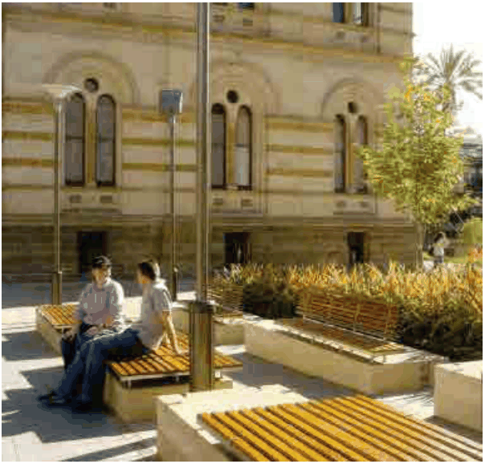

### 3.11 Public Domain and Amenity

#### 3.11.2 Public Squares and Forecourts Objectives

O1 To provide public squares and forecourts that are safe, accessible, comfortable and active for day and night use.

O2 To separate pedestrian and vehicular movements.

O3 To provide for a variety of passive and active uses.

#### Provisions

#### Advisory Note:

Figure 57 indicates the general location of existing and proposed public squares and forecourts within the BTC.

P1 The ground levels of developments that are adjacent to/have frontage to designated public squares and forecourts must provide active uses which address and define the edges of the squares and forecourts, and upper levels must enable casual surveillance.

P2 Developments must provide access to designated public squares and forecourts that is suitable for people with mobility impairment.

P3 The squares and forecourts must be unobstructed by buildings, open to the sky and have direct and physical linkages into and through the squares and forecourts.

> [Picture on page 134: a picture, saved as a picture (images/section-03-development-in-centres-and-corridors-page-134-18.gif, 150 dpi).]

#### Figure 58. Seating and Furniture in a Public Square
