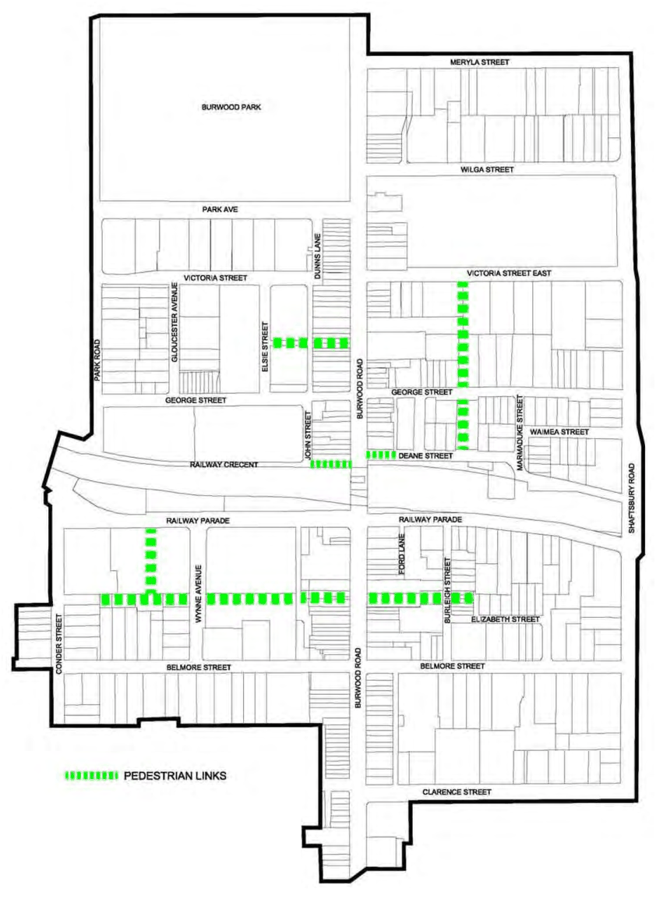

### 3.11 Public Domain and Amenity

> [Picture on page 137: a picture, saved as a picture (images/section-03-development-in-centres-and-corridors-page-137-2.gif, 150 dpi).]

#### Figure 60. Pedestrian Links in Burwood Town Centre

Pedestrian Link between Hornsey Street and Clarendon Place

P5 This pedestrian link must:

Have a minimum width of 9 metres

Be unobstructed by buildings and open to the sky for all of its width except where consent is given to the provision of awnings cantilevered from buildings located on land fronting the pedestrian link, and such awnings must not encroach on the width by more than 30%.
