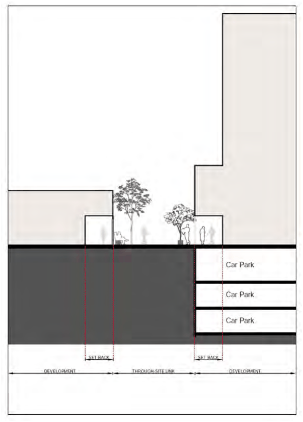

### 3.11 Public Domain and Amenity

Be activated by entrances to retail, office and residential uses.

Minimise barriers to mobility through the link including through compliance with AS 1428.1-2009 – Design for access and mobility - General requirements for access - New building work.

Have clearly identifiable access points that interact with the active edges of retail and business uses at ground level.

Be landscaped in accordance with Council’s Public Domain Plans as amended, and be of species selected from Council’s Street Tree Management Strategy.

P6 Passive surveillance from the upper levels of balconies and living areas must be provided.

P7 Where any outdoor retail activity is proposed, the shopfront must be setback from the pedestrian link, as shown in the Figure 61.

> [Picture on page 138: a picture, saved as a picture (images/section-03-development-in-centres-and-corridors-page-138-14.gif, 150 dpi).]

#### Figure 61. Setbacks for the Hornsey Street – Clarendon Place Pedestrian Link
