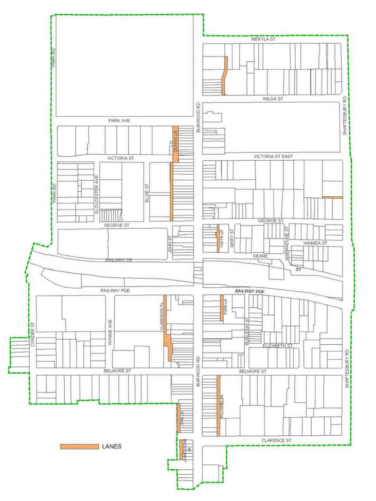

### 3.11 Public Domain and Amenity

#### 3.11.4 Lanes Objectives

O1 To retain and develop lanes as useful and interesting pedestrian connections as well as for service access.

#### Provisions

P1 Existing lanes in the BTC should be retained (refer to Figure 62).

P2 Where development has a frontage to a lane that is also a pedestrian route, the environment of the lane must be improved by providing design details that create visual interest and improve public safety and amenity.

> [Picture on page 139: a picture, saved as a picture (images/section-03-development-in-centres-and-corridors-page-139-11.gif, 150 dpi).]

Figure 62. Location of Lanes within the Burwood Town Centre
