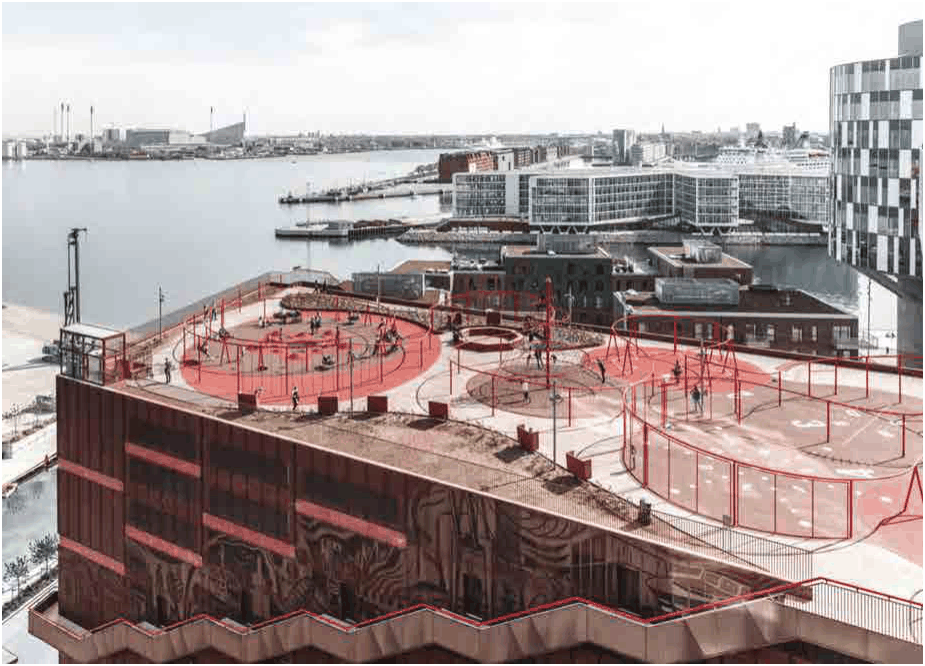

### 3.12 Liveability Improvements to Apartment Developments

#### 3.12.1 Activated Rooftop and Podium Communal Open Space

Burwood Council is embracing bold and forward-thinking approaches to enhance liveability in high-density apartment living by encouraging the inclusion of activated communal open spaces, preferably on rooftops and podium levels. These areas may incorporate a range of activities such as music and creative spaces for children, breakout or study areas for students and professionals, exercise and wellness facilities, sports activities such as basketball court or even rooftop swimming pools.

> [Picture on page 144: a picture, saved as a picture (images/section-03-development-in-centres-and-corridors-page-144-21.gif, 150 dpi).]

Figure 64: Rooftop activation example - Konditaget Lüders, Copenhagen, Denmark (Source: Google images)
