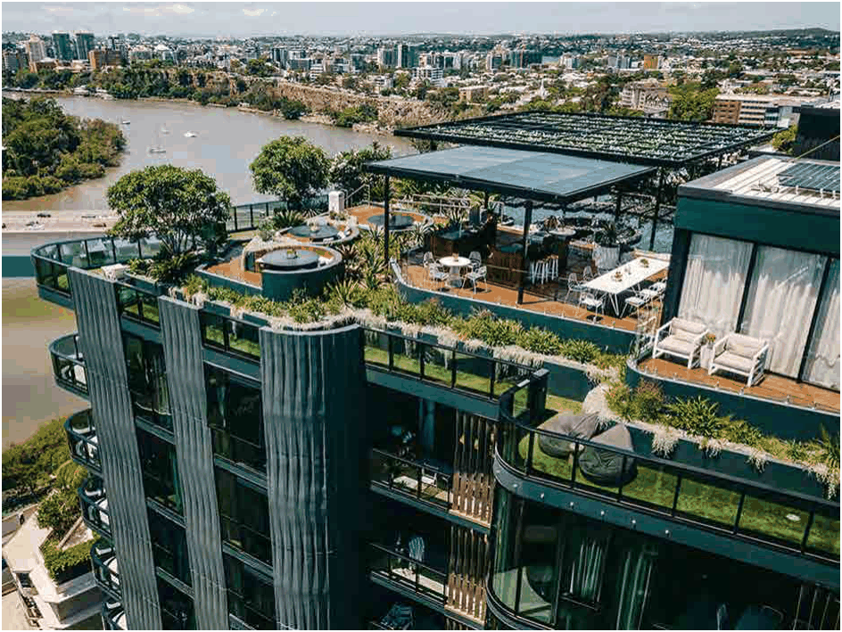

### 3.11 Public Domain and Amenity

> [Picture on page 145: a picture, saved as a picture (images/section-03-development-in-centres-and-corridors-page-145-2.gif, 150 dpi).]

Figure 65: Rooftop activation example – Brisbane, Australia (Source: Google images)

As the demand for apartment living continues to rise across the Burwood LGA, these spaces are essential to support recreation, social connection, and wellbeing where access to ground-level open space is limited.

Developments are encouraged to adopt innovative communal space designs that respond to the unique needs and lifestyles of their residents. Council places particular emphasis on providing music and creative rooms for children, breakout or study areas for students and professionals, and exercise/wellness facilities as part of these activated spaces. Alternative forms of communal activation that align with the intent of enhancing liveability and social interaction will also be considered on their individual merit, having regard to their design quality, functionality, and overall contribution to community life and wellbeing.

The design of activated rooftop and podium communal spaces is expected to demonstrate design excellence consistent with the Burwood LEP Design Excellence Clause 6.5. These spaces should be conceived as integral elements of the overall architectural, landscape and urban design of a development, rather than as ancillary or residual areas. High-quality design outcomes should be achieved through careful consideration of building form, materials, landscape integration, circulation, accessibility, environmental performance and long-term functionality. Well-designed rooftop and podium communal spaces can enhance residential amenity, contribute to urban greening and climate resilience, and reinforce positive relationships between private development and the public and private domain, supporting Council’s broader objectives for high-quality, liveable and well-designed apartment development.
