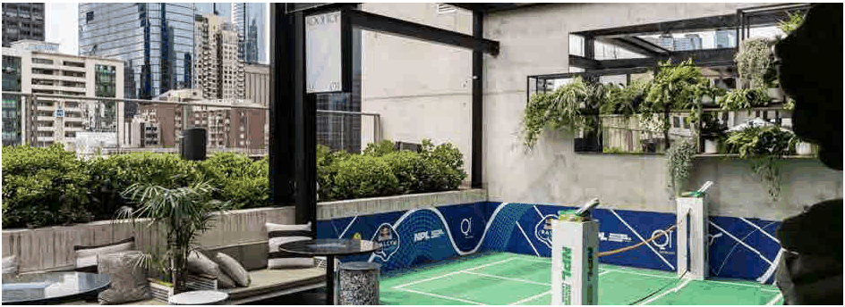

### 3.11 Public Domain and Amenity

> [Picture on page 147: a picture, saved as a picture (images/section-03-development-in-centres-and-corridors-page-147-2.gif, 150 dpi).]

#### Figure 68: Rooftop activation example – Melbourne, Australia

#### Objectives

O1 To ensure rooftop and podium communal open spaces or residential accommodation are high-quality, accessible, and actively used recreational and social areas that enhance community interaction and provide meaningful outdoor opportunities in a high-density environment where ground-level open space is limited.

O2 To respond to the growing demand for open space from increasing apartment development by requiring the activation of rooftop and podium communal areas through design that promotes liveability, urban greening, and climate resilience, while fostering a vibrant sense of community and wellbeing for all residents.

O3 To encourage the inclusion of diverse activities within activated rooftop and podium spaces, such as, breakout areas for students/professionals, and exercise or wellness facilities, music or creative studios etc that support social connection, creative expression, and healthy living in high-density residential environments.

O4 To ensure that the design of activated rooftop and podium communal spaces demonstrates design excellence consistent with the requirements of the  Burwood LEP Design Excellence Clause 6.5, by achieving a high standard of architectural, landscape and urban design, integrating these spaces with the overall building form and circulation, and ensuring they contribute positively to residential amenity, environmental performance, and the quality of both the public and private domain.
