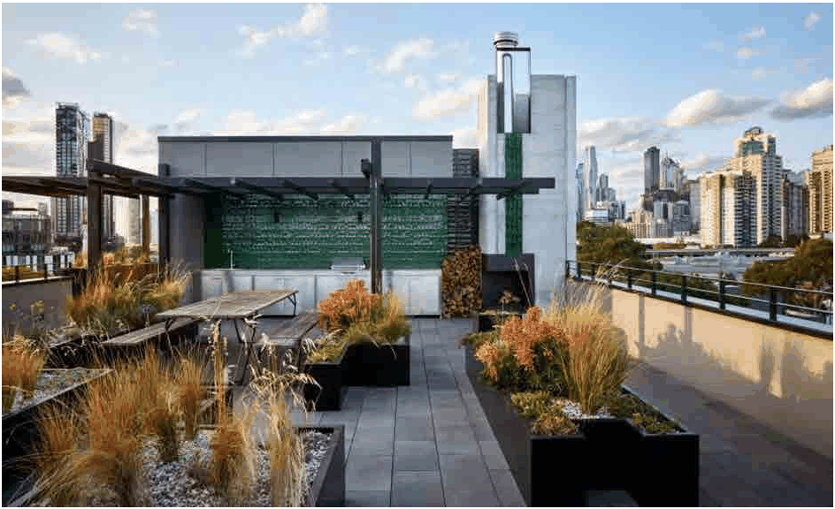

### 3.11 Public Domain and Amenity

> [Picture on page 148: a picture, saved as a picture (images/section-03-development-in-centres-and-corridors-page-148-2.gif, 150 dpi).]

Figure 69: Rooftop activation example – Melbourne, Australia (Source: Google images)

#### Controls

P1 Building rooftops including podiums that are designated communal open space must be designed to meet the performance requirements of the National Construction Code (Building Code of Australia) NCC.

P2 Any proposed communal open space for residential accommodation located on the building podium and/or rooftop is to:

a) Be consolidated into a useable area with a minimum width of 6m and a minimum area of 36m².

b) Be located so that solar access is provided for users of the communal open space between 10.00 am and 2.00 pm on 21 June.

c) Be designed to a high quality with universal access and allow for landscaping, seating and safety to the users.

d) Be structurally sound and have adequately draining soil base to support healthy plant growth.

e) Have no direct sightlines to the habitable room windows and private open space of the adjoining and on-site residences.

f) Not result in unreasonable noise impacts on the adjoining residences, justified in the Management Plan.

g) Any shading devices, privacy screens and planters should not adversely increase the visual bulk of the building.

h) Any stairway and associated roof should not detract from the architectural character of the building, and be positioned to minimise direct and oblique views from the street.

i) The provision of landscape planting on the roof (green roof) must be designed by a qualified landscape architect or designer with details shown on a landscape plan.
