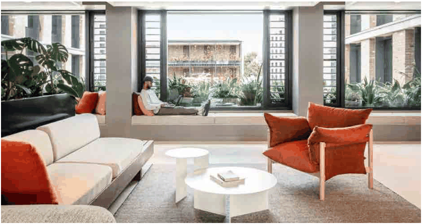

### 3.11 Public Domain and Amenity

> [Picture on page 150: a picture, saved as a picture (images/section-03-development-in-centres-and-corridors-page-150-2.gif, 150 dpi).]

#### Figure 70 Example of Breakout area (Source: Google images)

P5 Development within Residential Accommodation comprising more than 60 dwellings is encouraged to provide at least one communal co-working or study area, designed to accommodate students and residents working from home.

P6 When provided, breakout areas must ensure they:

Are accessible to all residents; Incorporate natural light and ventilation; Provide appropriate furnishings, power outlets, and digital connectivity; and Are located to minimise noise conflicts with adjoining dwellings.

P7 Development within Residential Accommodation comprising more than 60 dwellings is encouraged to provide on-site exercise facilities such as gyms, fitness studios, or active recreation spaces.

P8 When provided, exercise facilities must ensure they:

Are designed with appropriate acoustic treatment to prevent noise transfer; Provide adequate ventilation and natural light; and Are accessible to all residents
