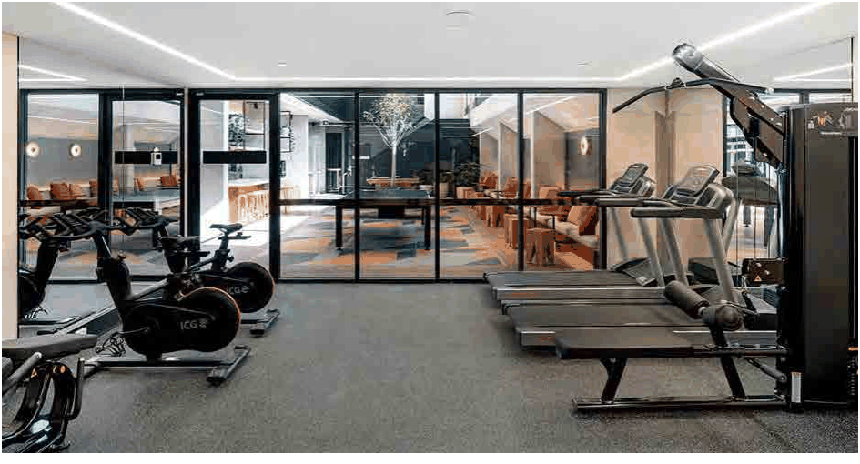
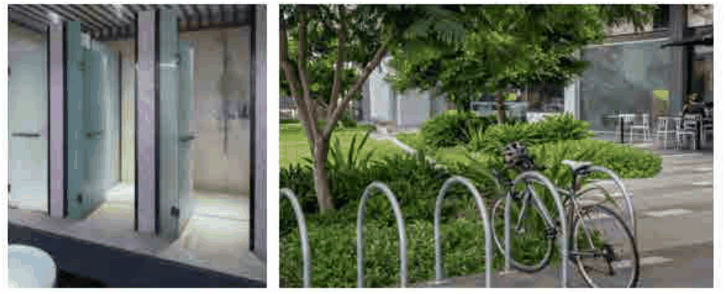

### 3.11 Public Domain and Amenity

> [Picture on page 151: a picture, saved as a picture (images/section-03-development-in-centres-and-corridors-page-151-2.gif, 150 dpi).]

#### Figure 71: Example of on-site exercise facility (Source: Google images)

#### 3.12.2 End of Trip Amenities Objectives

O1 To encourage alternatives to private motor vehicle use and support sustainable transport, such as public transport, walking or cycling.

O2 To encourage active and healthy lifestyles, sustainable transport choices, and opportunities for social connection within apartment developments.

> [Picture on page 151: a picture, saved as a picture (images/section-03-development-in-centres-and-corridors-page-151-10.gif, 150 dpi).]

#### Figure 72 End of Trip facilities (Source: Google images)

#### Controls

P1  Mixed use and Commercial development must provide end-of-trip amenities on site, including:

a) Secure, accessible bicycle parking;
