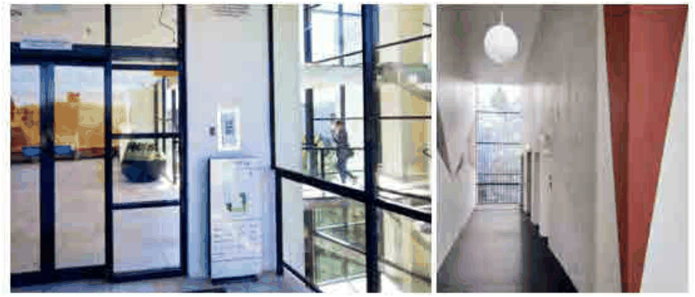

### 3.11 Public Domain and Amenity

b) Lockers; and

c) Shower and change facilities, must be accessible, secure, unisex and ventilated consistent with the requirements of National Construction Code (NCC).

P2  The end of trip amenities must be safe, well-lit, signposted, weather protected and secure for the users of the development to meet the requirement of NCC.

P3 End-of-trip amenities are to be conveniently located near building entries or communal circulation areas, and not to be located on through-site link land and footpath widening areas.

P4  Bicycle storage must be located with good passive surveillance and direct, level or ramped access to the primary pedestrian entry or street. Basement bike parking should be on the uppermost basement level adjacent to pedestrian exits. Visitor bicycle parking must be provided on grade close to the main entrance. The path from bike parking to the entry must be a minimum clear width of 1.5 m.

#### 3.12.3 Corridors and Internal Circulation

#### Objectives

O1 To create safe and pleasant spaces for circulation of residents and visitors and their possessions.

O2 To facilitate good apartment layout with optimal environmental performance.

O3 To contribute positively to the built form and façade articulation.

> [Picture on page 152: a picture, saved as a picture (images/section-03-development-in-centres-and-corridors-page-152-21.gif, 150 dpi).]

#### Figure 73 Internal circulation and corridor widths, Source: ADG

#### Controls

P1 Internal corridors must provide a clear width of 1.5 m. Where bicycle circulation or furniture movement is likely, allow 1.5 m clear width. Internal residential corridors must comply with the BCA and AS 1428 (accessibility) requirements

P2 Corridors must incorporate natural light and ventilation through windows, atriums, or light wells to reduce confinement and improve amenity. Developments must demonstrate the following to improve internal circulation:
