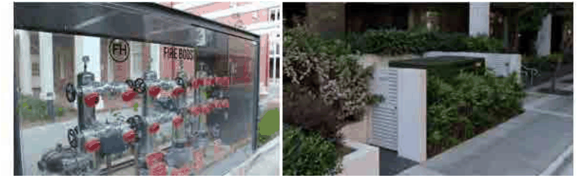
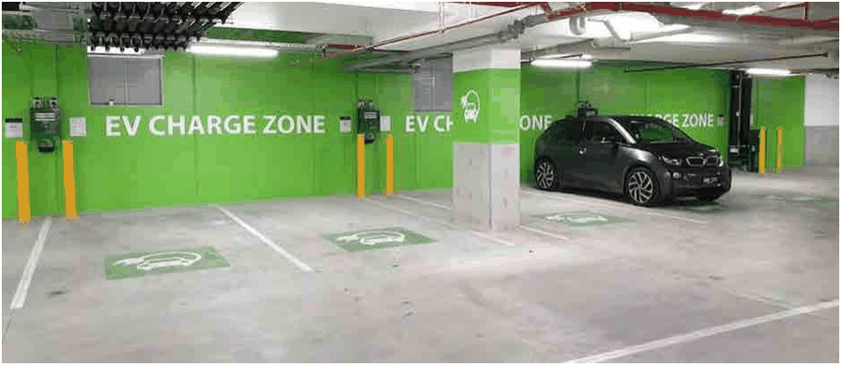

### 3.11 Public Domain and Amenity

> [Picture on page 154: a picture, saved as a picture (images/section-03-development-in-centres-and-corridors-page-154-2.gif, 150 dpi).]

Figure 74 Integration of substation, hydrant & boosters with landscaping and building elements (Source:

#### Google images)

#### 3.12.5 EV Readiness and EV Charging Objectives

O1 To ensure new development is designed and constructed to enable safe, efficient and cost-effective electric vehicle (EV) charging for residents, visitors and building services.

O2 To reduce emissions associated with transport and support Council’s sustainability objectives by enabling uptake of electric vehicles.

O3 To future-proof parking infrastructure so on-site charging can be provided with minimal retrofit cost and minimal disruption to occupants.

O4 To ensure EV charging infrastructure is safe, accessible, equitable and integrated with building electrical services and strata management arrangements.

> [Picture on page 154: a picture, saved as a picture (images/section-03-development-in-centres-and-corridors-page-154-15.gif, 150 dpi).]

#### Figure 75: EV readiness and EV charging (Source: Google images)

#### Controls

P1 EV charging infrastructure (provision of a backbone cable tray and a dedicated space15A circuit with an EV Distribution Board) in private car spaces must be safely integrated into the car parking design and must not obstruct vehicle manoeuvring or pedestrian access, satisfying the NCC requirements.
