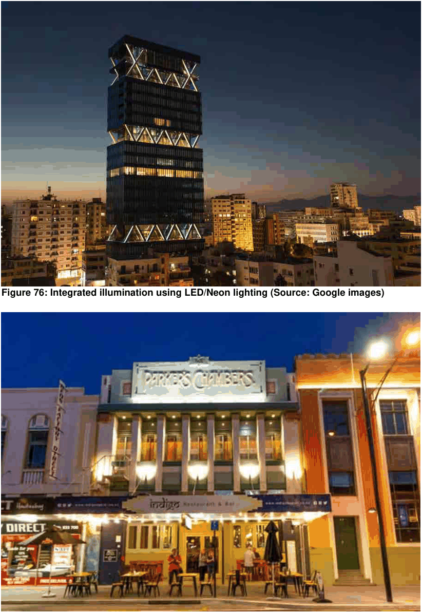

### 3.11 Public Domain and Amenity

O5 To ensure lighting respects the heritage significance and character of existing buildings and streetscapes.

> [Picture on page 156: a picture, saved as a picture (images/section-03-development-in-centres-and-corridors-page-156-4.gif, 150 dpi).]

Figure 76: Integrated illumination using LED/Neon lighting (Source: Google images)

#### Figure 77: Façade illumination in heritage settings (Source: Google images)
