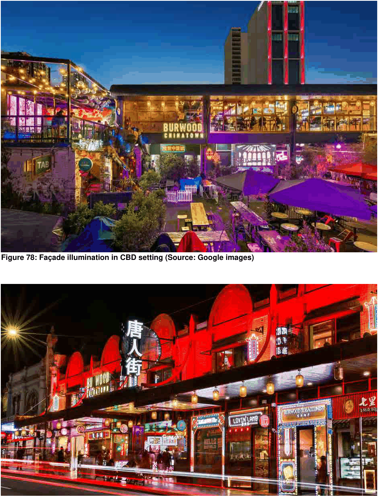

### 3.11 Public Domain and Amenity

> [Picture on page 157: a picture, saved as a picture (images/section-03-development-in-centres-and-corridors-page-157-2.gif, 150 dpi).]

#### Figure 78: Façade illumination in CBD setting (Source: Google images)

#### Figure 79: Neon façade illumination in CBD setting (Source: Google images)
