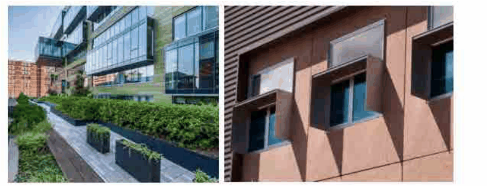

### 3.11 Public Domain and Amenity

P2 Minimise western glazing, use roof overhangs (eaves) and incorporate additional shading to balconies/verandas, where possible.

P3  Green roofs are encouraged, wherever practical incorporating a range of low maintenance vegetation and native plants including a variety of plant sizes, layers of planting inclusive of fruit and vegetable gardens.

P4  Stormwater from roofs, streets, pavements and lawns are to be captured and re-used, wherever possible.

P5 The roof materials of new buildings shall incorporate light colours to prevent the urban heat island effect.

P6 Stormwater drainage and on-site detention is to be designed in accordance with Council’s Stormwater Management Code

P7 Drainage systems must be sized to consider increases in rainfall intensity, frequency and duration under future climate change.

> [Picture on page 160: a picture, saved as a picture (images/section-03-development-in-centres-and-corridors-page-160-15.gif, 150 dpi).]

#### Figure 80: Green roofs and window overhangs (Source: Google images)
