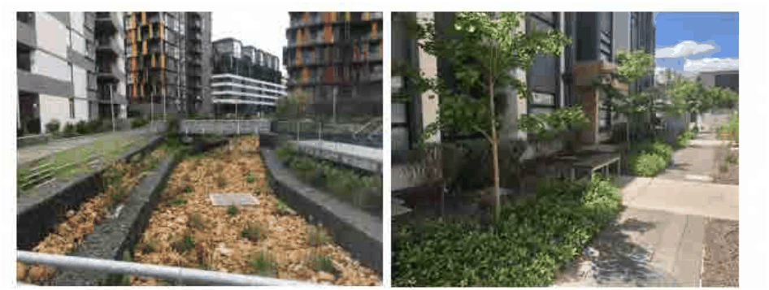

### 3.11 Public Domain and Amenity

P10 The construction of stormwater drainage lines through public reserves or land that may be dedicated to Council is not permitted

P11 Stormwater drainage is to be designed in accordance with Council’s Stormwater Management Code.

P12 Stormwater runoff must not adversely impact surrounding properties or Council infrastructure and assets through the diversion and concentration of flows.

P13 For developments connecting to the existing site stormwater drainage system, a plan indicating the layout and details of the existing system, along with a certificate from a qualified and practicing plumber certifying the functionality and condition of the system, must be submitted with the Development Application.

P14  All developments involving site disturbance must include details of Erosion and Sedimentation Control measures designed in accordance with the Soil and Water Management for Urban Development – NSW Department of Housing and Stormwater Management Code.

P15  Connection of any stormwater or drainage systems to Council’s systems must be undertaken in accordance with Council’s Stormwater Management Code.

P16 Charged drainage is permitted within the development. However, the final discharge of stormwater to Council infrastructure must be by gravity.

P17 Private drainage easements must be designed and located on the lower side of a property, be free of building encroachments and must comply with Council’s Stormwater Management Code.

> [Picture on page 162: a picture, saved as a picture (images/section-03-development-in-centres-and-corridors-page-162-23.gif, 150 dpi).]

Figure 81: Integrated Water Sensitive Urban Design on the ground plane (Source: Google images)
