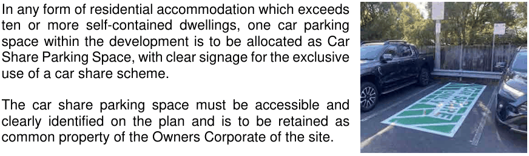

### 3.11 Public Domain and Amenity

#### 3.12.9 Car Share Parking Space

#### Objectives

To facilitate sustainable transport choices by providing well-located and accessible car share parking spaces within new developments and public areas, thereby reducing private car ownership, supporting active and public transport use, and optimising the efficiency of limited

> [Picture on page 163: a picture, saved as a picture (images/section-03-development-in-centres-and-corridors-page-163-7.gif, 150 dpi).]

parking and road space.

#### Controls

P1 In any form of residential accommodation which exceeds ten or more self-contained dwellings, one car parking space within the development is to be allocated as Car Share Parking Space, with clear signage for the exclusive use of a car share scheme.

P2 The car share parking space must be accessible and clearly identified on the plan and is to be retained as common property of the Owners Corporate of the site.
