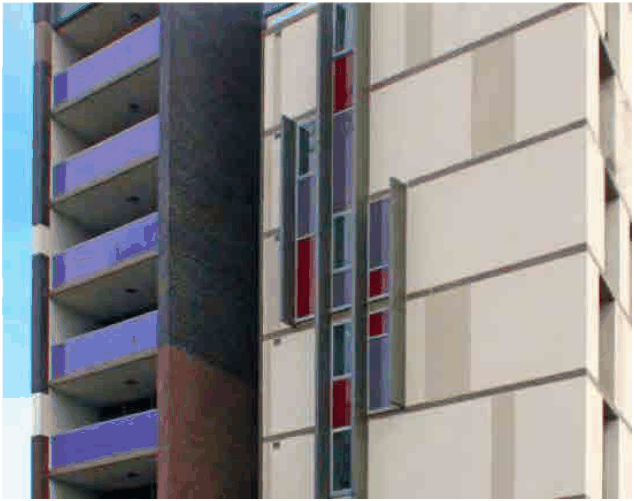

### 4.1 Residential Flat Buildings in R1 Zone

#### Provisions

Building Facades and General Guidelines

P1 Each street façade must be articulated into smaller components using building elements (materials, floor slabs, balconies, window and door elements, roof forms and the like) at a scale or grain that reflects the use of the building and its components its location relative to public domain elements and has a clearly defined top, middle and bottom.

P2 Predominant scale, rhythm and modulation of the existing streetscape are to be used as a baseline to break the new facade into smaller and finer elements. Vertical planes are encouraged over horizontal planes.

P3 Façade modulation/ articulation should reflect the key datum lines of the adjacent heritage or local contributory items.

P4 Uninterrupted blank wall is to be avoided in all visible parts of the façade from the public domain or adjacent neighbourhood.

Blank wall should demonstrate visual interest through articulation of material and incorporation of  temporary or permanent public art installations created by local artists, integrated with the overall façade design.

This shall be in accordance with the requirements of the Burwood Public Art Guideline for Developers.

> [Picture on page 4: a picture, saved as a picture (images/section-04-development-in-residential-areas-page-4-20.gif, 150 dpi).]

Modulation and articulation of the blank wall to enhance the visual character of the building.

Source: ADG, 4M

P5 A simplified response to the BDCP required side and rear setbacks and separation distances is encouraged.
