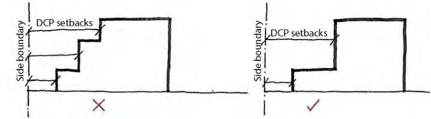
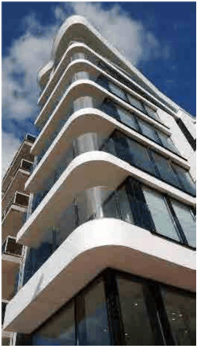

### 4.1 Residential Flat Buildings in R1 Zone

> [Picture on page 5: a picture, saved as a picture (images/section-04-development-in-residential-areas-page-5-2.gif, 150 dpi).]

P6 Front and rear façades are to include 60% - 70% windows and balconies of habitable rooms.

P7 A minimum of 30% - 50% of side façades should include windows and balconies of habitable rooms. Where building separation distances are less than the ADG guidelines, features are encouraged to redirect views to avoid adverse privacy impacts.

P8 A minimum of 70% of the northern façade is to include windows and balconies of habitable rooms.

P9 Horizontal Shading on the northern façades and vertical shading for eastern/western facades are encouraged to control heat gain and glare to the internal areas.

P10 New developments on corner sites should orient to both street frontages.

P11 Accentuate the corner’s unique location with architectural features that actively engage the public realm and create a visual presence at the corner, such as:

- Chamfered or rounded corners

- Different material and colours

- Recessed balconies or windows

- Vertical articulation/modulation

P12 Corner entrances should address the two street frontages.

> [Picture on page 5: a picture, saved as a picture (images/section-04-development-in-residential-areas-page-5-20.gif, 150 dpi).]

Changing the façade material, articulation or colour to highlight prominent corners.
