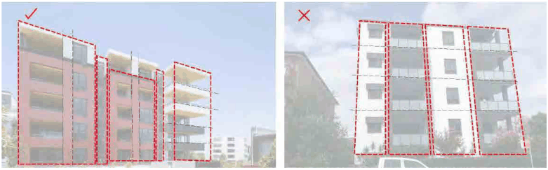
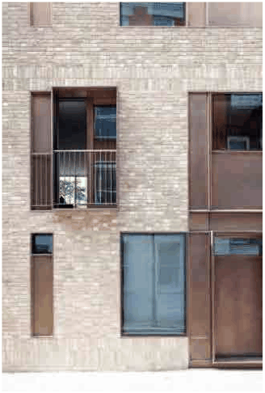

### 4.1 Residential Flat Buildings in R1 Zone

(Source: ADG, 4M)

P13 Integrate building service elements, such as drainage pipes, grilles, screens, ventilation louvres and car park entry doors into the overall facade design.

P14 A variety of architectural modulation, rhythm and fenestration is required to enhance the façades visual character.

> [Picture on page 6: a picture, saved as a picture (images/section-04-development-in-residential-areas-page-6-7.gif, 150 dpi).]

P15 Openings are to be recessed at a minimum of 100mm to add depth to the façade.

P16 Recessed balconies are preferable to provide privacy, protection and depth to the façade.

P17 Sliding louvred panels screening the balconies are encouraged to add visual privacy and control the solar access.

P18 Residential flat buildings of 5 storeys and more should have a distinguished base, middle and top in their façade design. New buildings up to 4 storeys and below should have a distinguished base and top.

P19 The pedestrian entries to buildings shall be readily apparent from the street, and that part of buildings adjacent to the public street shall have living room or kitchen windows

> [Picture on page 6: a picture, saved as a picture (images/section-04-development-in-residential-areas-page-6-18.gif, 150 dpi).]

facing the street.

Recessed openings add depth to the overall façade. (Source: GMU Library)

Building Base

P20 This applies within the first 1-2 storeys of the residential flat buildings with 5 storeys and more.
