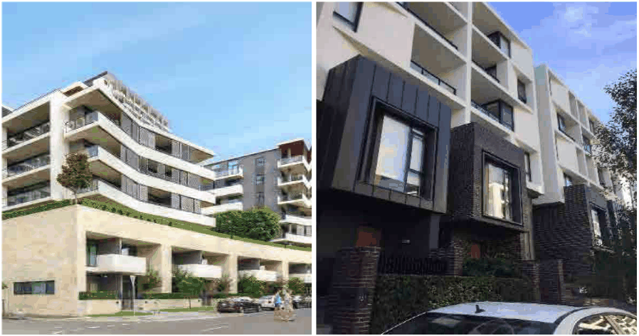
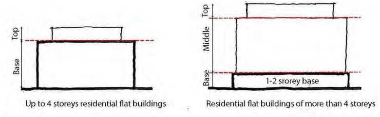

### 4.1 Residential Flat Buildings in R1 Zone

P21 A clearly defined base is encouraged through the use of different materials, textures and articulation to reinforce the character of the public domain.

> [Picture on page 7: a picture, saved as a picture (images/section-04-development-in-residential-areas-page-7-4.gif, 150 dpi).]

Example of a clearly defined base, middle and top. (Source: Google)

> [Picture on page 7: a picture, saved as a picture (images/section-04-development-in-residential-areas-page-7-6.gif, 150 dpi).]

P22 Differentiating building entrances is required through different materials, textures and articulation.

P23 Parking entrances are to be encapsulated within the building envelope on primary and secondary elevations that have direct access to a public road and are to have a maximum aperture or length of 6 metres.

P24 Service/parking entrances are to be integrated with the overall façade design using quality material and finishes.

P25 All materials surrounding the entry and lining the inside or any part of ramps that are visible from the public domain when security grills are open are to be integrated with the overall design and be of high quality materials and finishes.
