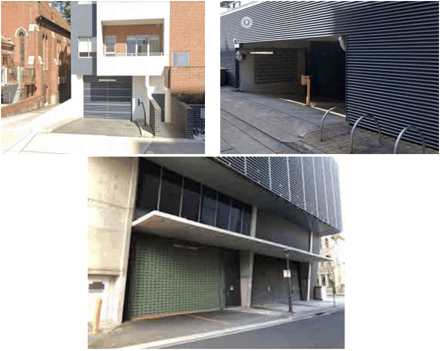

### 4.1 Residential Flat Buildings in R1 Zone

> [Picture on page 8: a picture, saved as a picture (images/section-04-development-in-residential-areas-page-8-2.gif, 150 dpi).]

Figure 82. Examples of parking entrances encapsulated within the building envelope

P26 The base is to be integrated with the landscape character of the building. Using natural material such as brick and sandstone with recessive colour to blend the building with its natural context is encouraged.
