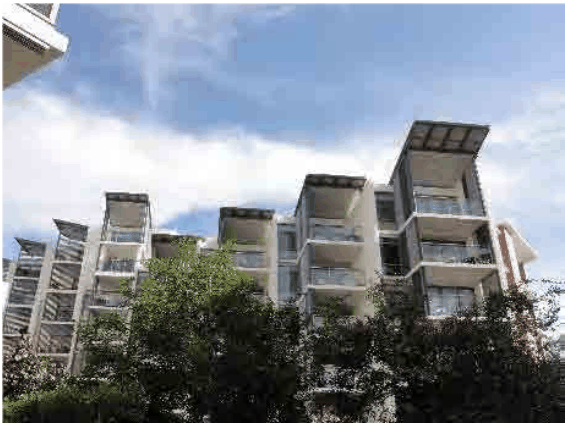

### 4.1 Residential Flat Buildings in R1 Zone

Building Middle

P26 Façade segments are to be articulated with different façade planes, materials and textures every 10-15m.

P27 Façade rhythm and articulation should reinforce the predominant scale of the adjacent developments.

Roof Top and Roof Gardens

P28 Roof design is to be integrated with the overall built form and respond to the predominant roof character of the surrounding neighbourhood. A roof termination or a distinctive roof design is encouraged.

P29 Different façade expressions including articulation, material, parapet, colour and texture to differentiate the top level and roof are encouraged.

> [Picture on page 9: a picture, saved as a picture (images/section-04-development-in-residential-areas-page-9-13.gif, 150 dpi).]

Examples of the roof character integrated with the overall façade design.

(Source: GMU Library, Google)

P30 Visually recessive building tops to create greater aperture to the sky and reduce the perception of bulk and scale are encouraged.

P31 Rooftop design should take into account potential views from surrounding taller buildings. Green roofs and roof gardens or patios will enhance rooftop appearance from surrounding buildings.

P32 The design of the roof should respond to the orientation of the site, minimise the visual intrusiveness of service elements (which should be integrated with the roof design) and facilitate the use of the roof for communal open space.

P33 Residents shall have access to rooftop and podium gardens wherever possible. At least 50% of the roof area shall be vegetated with grasses, shrubs and trees.

P34 Planter boxes must be located at the perimeter of rooftop gardens to minimise overlooking of neighbouring dwellings.

P35 Planting containers must allow sufficient depth and volume, growing medium and irrigation to support the mature size of plants.

P36 All planting areas on structures must be designed by a suitably qualified engineer.
