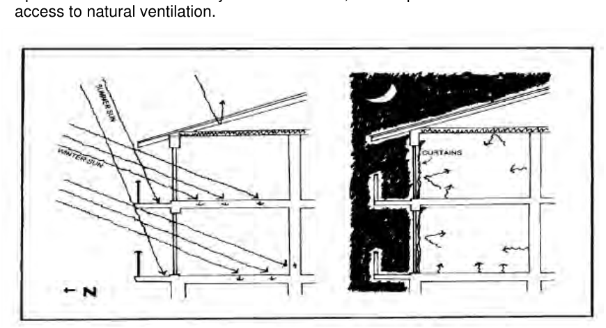

### 4.1 Residential Flat Buildings in R1 Zone

Where a  basement carpark protrudes to deep soil areas, provide suitable two horizon topsoil growing medium, including a drainage layer to allow for mature tree growth

P11 It is expected that 25% - 30% of the site be landscaped (inclusive of the deep soil zone). Landscaped area includes all pervious surfaces, open space at ground level and open space with a minimum dimension of 1 metre.

P12 Information on landscaping of the site prepared by a Landscape Architect or practicing Landscape Consultant shall be required as part of the development approval process.

P13 The requirements of Council’s Landscaping Code shall be complied with for the retention of existing trees and planting of new trees.

P14 Any residential flat building with a flat roof is expected to provide a rooftop garden in accordance with Section 4.1.2 above.

Solar Access and Natural Ventilation

P15 DAs are to include diagrams in plan and elevation that shows sun access to proposed apartments and the shadow impact on neighbouring dwellings from the proposal at 9.00am, 12.00pm and 3.00pm on March 21 and June 21.

P16 At least 70% of the living rooms and private open spaces of the proposed apartments and neighbouring developments are to receive a minimum of 3 hours direct sunlight between 9.00am and 3.00pm on June 21.

P17 Where the neighbouring development currently receives less than 3 hours direct sunlight to living areas/habitable rooms or to the private open space area, any additional overshadowing is to be minimised.

P18 Apartments shall be naturally cross-ventilated, and in particular kitchens should have access to natural ventilation.

> [Picture on page 11: a picture, saved as a picture (images/section-04-development-in-residential-areas-page-11-25.gif, 150 dpi).]

#### Figure 83. Solar Access and Insulation

Visual Privacy

P19 Provide adequate building separation in accordance with the building separation requirements in the ADG.

P20 Avoid overlooking to and from private open space and the main habitable areas of dwellings through building layout and location, design and location of windows and screening devices, balcony design and distance.
