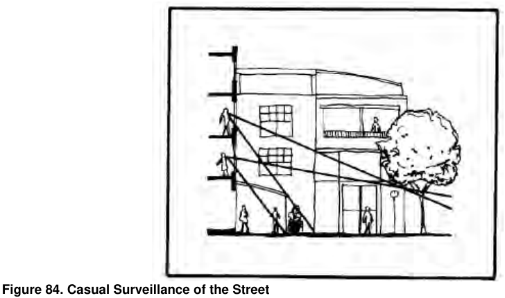

### 4.1 Residential Flat Buildings in R1 Zone

Acoustic Amenity

P21 The internal layout of buildings is to be designed to reduce the effects of noise transmission through building materials and locating noise generating areas together.

P22 The layout and soundproofing of apartments shall limit noise transmission between apartments, and from adjoining sites particularly from noise sites.

P23 The provisions of 3.2.14 Visual and Acoustic Privacy P3 to P7 are to apply to Residential flat buildings in the R1 zone.

Safety and Security

P24 Design of developments must provide personal and property security for residents and visitors and enhance perceptions of community safety.

P25 A Crime Risk Assessment in compliance with Crime Prevention Through Environmental Design (CPTED) requirements is to be prepared by a suitably qualified consultant is required for DAs of more than 20 dwellings.

P26 Each building shall be provided with an entry that creates a sense of identity for the development.

P27 Buildings shall be designed to provide casual surveillance, have appropriate lighting, clearly defined territory and avoid concealed or blind spots.

> [Picture on page 12: a picture, saved as a picture (images/section-04-development-in-residential-areas-page-12-19.gif, 150 dpi).]

#### Figure 84. Casual Surveillance of the Street

Fences and Walls

P28 The design and materials of fences and walls must be sympathetic to the streetscape, visually attractive and complement landscape elements.

P29 The height (as measured from the public footpath side) of the front fencing must be: Not higher than 1.2 metres above ground level (existing), and with a maximum solid base component of 0.9 metres high. Not higher than 1.5 metres above ground level (existing) if the fence follows a sloping site and is stepped to accommodate the fall in the land, and with a maximum solid base component of 1m high.
