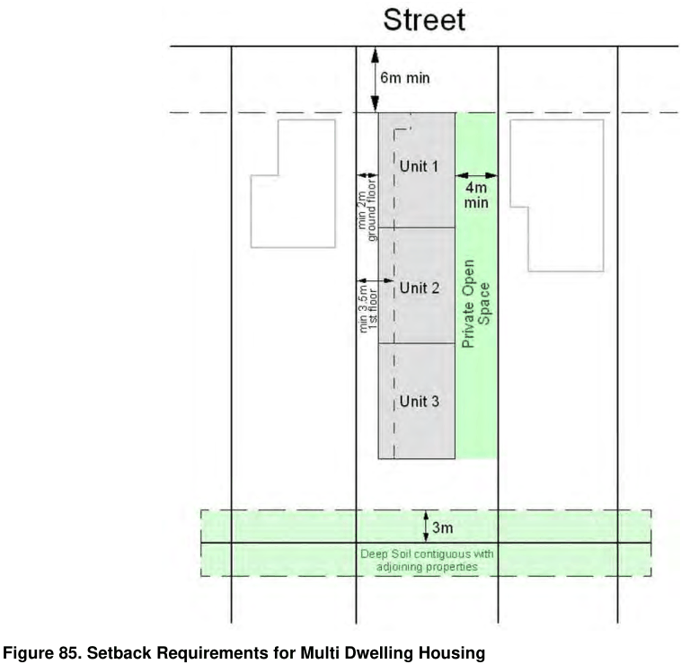

### 4.3 Multi Dwelling Housing

P3 The rear setback of a building is to be a minimum of 3 metres.

P4 Setback areas must be free of projections or encroachments, except for at-grade landscaping, to protect the amenity of adjoining properties and the streetscape.

Building Separation

P5 The requirements for the separation of buildings on a site are shown in Figure 86:

A minimum of 12 metres between buildings within the development site where habitable rooms face other habitable rooms A minimum of 9m between buildings within the development site where habitable rooms face non-habitable rooms or blank walls A minimum of 3m metres between buildings within the development site where non-habitable rooms face other non-habitable rooms or blank walls

> [Picture on page 17: a picture, saved as a picture (images/section-04-development-in-residential-areas-page-17-13.gif, 150 dpi).]

#### Figure 85. Setback Requirements for Multi Dwelling Housing
