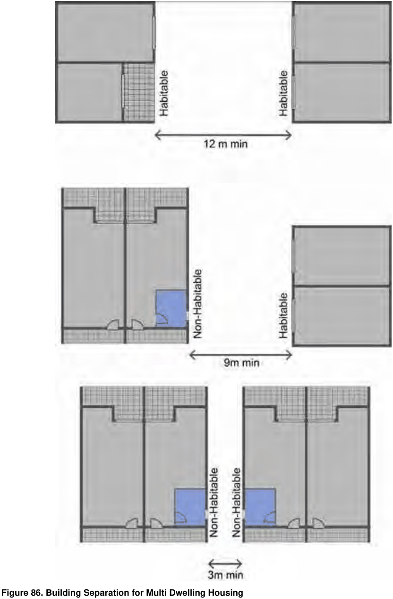

### 4.3 Multi Dwelling Housing

> [Picture on page 18: a picture, saved as a picture (images/section-04-development-in-residential-areas-page-18-2.gif, 150 dpi).]

#### Figure 86. Building Separation for Multi Dwelling Housing
