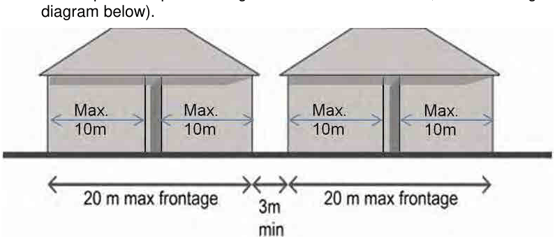
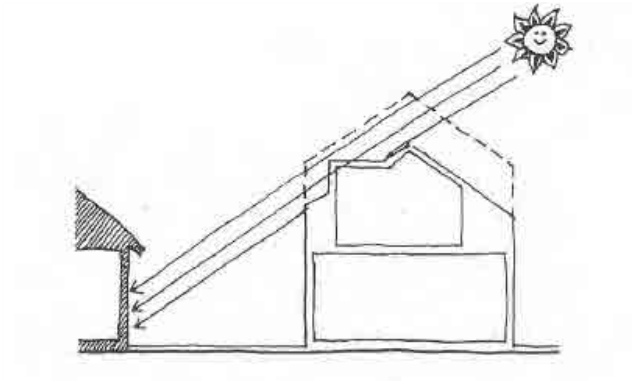

### 4.3 Multi Dwelling Housing

Building Widths and Breaks

P6 The maximum width of a building facing a street is 20 metres (see diagram below). A maximum length of uninterrupted building frontage of 10m for terrace or townhouse development in order to achieve substantial articulation in the form of an indent, recess or physical break along the length of the elevation.

P7 Breaks between buildings facing a street should be a minimum of 3 metres wide, and where possible provide alignment with other streets, lanes or regional views (see diagram below).

> [Picture on page 19: a picture, saved as a picture (images/section-04-development-in-residential-areas-page-19-10.gif, 150 dpi).]

#### Figure 87. Maximum Building Width and Building Breaks at Street Frontage

P8 A building facade within a development shall not exceed a horizontal dimension of 14 metres without adequate articulation.

Site Frontage and Site Isolation

P9 The minimum site frontage required for single storey development is 15 metres, and for two storey development is 17 metres.

P10 For single storey development, attic rooms and dormer windows are allowed which must be incorporated within the roof features.

> [Picture on page 19: a picture, saved as a picture (images/section-04-development-in-residential-areas-page-19-19.gif, 150 dpi).]

#### Figure 88. Use of Attic Rooms and Dormer Windows. Source: AMCORD 19

P11 Site consolidation is encouraged to promote efficient use of land and avoid the creation of isolated sites.

P12 The provisions concerning Site Isolation in Section 4.1.2 also apply to the development of multi dwelling housing.
