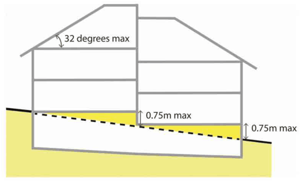

### 4.3 Multi Dwelling Housing

#### Building Design Objective

O1 To ensure the appearance of new development defines and enhances the public domain through modulation, articulation, materials and sensitivity to heritage items and areas.

#### Provisions

Building Facades

P1 The façade elements (windows, balconies, gables) must be articulated and relate to the scale and character of the context.

P2 A mix of building materials and colours should be used to reduce the appearance of bulk and integrate the building within the materials and colour palettes of the local area.

P3 The frontage of buildings and their entries shall be readily apparent from the street, with buildings adjacent to the public street having a front door and living room or kitchen window facing the street.

Roof Design

P4 The design of the roof should respond to the orientation of the site.

P5 The design of the roof shall be integrated with the proposed built form and consistent with adjacent properties, and reduce the bulk and scale of the roof through articulation.

P6 The maximum permitted roof pitch is 32 degrees (Refer to Figure 89).

P7 Attic rooms must be contained wholly within the roof structure, however Council may consent to dormer windows and similar projections only when it is satisfied the privacy of neighbours is protected.

Car Parking and Ground Level

P8 Where parking spaces are provided in a basement it is to be located fully below natural ground level however where slope conditions necessitate protrusion above natural ground level, the protrusion is not to exceed 0.75 metres otherwise it will be counted as floor area (Refer to Figure 89).

> [Picture on page 20: a picture, saved as a picture (images/section-04-development-in-residential-areas-page-20-28.gif, 150 dpi).]

Figure 89. Maximum Projection for Basement Car Parks on Sloping Sites and Maximum Roof Pitch
