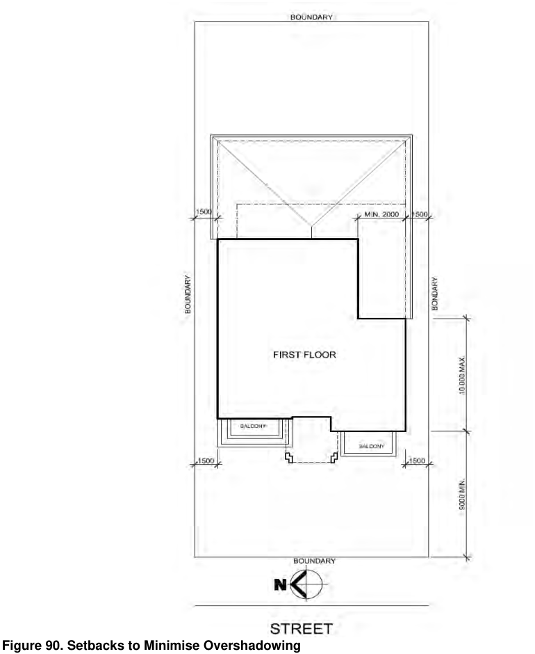

### 4.4 Dual Occupancies and Secondary Dwellings

> [Picture on page 30: a picture, saved as a picture (images/section-04-development-in-residential-areas-page-30-2.gif, 150 dpi).]

#### Figure 90. Setbacks to Minimise Overshadowing
