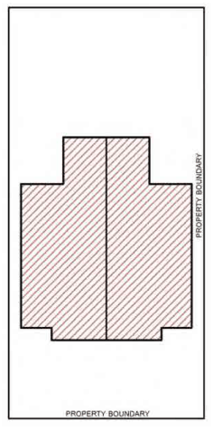

### 4.4 Dual Occupancies and Secondary Dwellings

Duplex Development

Duplex refers to two dwellings on a single lot that are positioned side by side when viewed from the street. It is a form of an attached dual occupancy.

> [Picture on page 31: a picture, saved as a picture (images/section-04-development-in-residential-areas-page-31-5.gif, 150 dpi).]

#### Figure 91. Understanding Duplex Development

P39 Duplex development will not be supported in streets and sites subject to Building Appearance and Streetscape Provisions under Section 4.5. Refer to the map at Appendix 8.2.

P40 Duplex development requires a minimum site frontage of 15 metres.

P41 Duplex development will not be supported on battleaxe lots. For corner allotments, both street frontages must each be a minimum of 15 metres.

P42 Garage door openings including intermediate piers and carports must not exceed 40% or 7.5 metres (whichever is the lesser) of the entire width of the front elevation of the duplex.

P43 Garages and carports must not be erected within the established duplex setback and the street alignment.

P44   A minimum of 50% of the front setback (i.e. front yard) is to consist of soft landscaping.

P45 Duplexes must provide variation in the design of the front façade of each dwelling. Mirror imaged duplexes, incorporating protruding garages facing the street, will not be supported by Council.

P46 Duplexes should be designed in a way to have the appearance of a typical single dwelling house when viewed from the street.

P47 Garaging of more than two cars (i.e. one for each dwelling) is considered excessive. The floor area of any further car space will be included in the gross floor area calculations.

#### Advisory Note:

Duplexes must comply with all other provisions of Section 4.4 Dual Occupancies and Secondary Dwellings.
