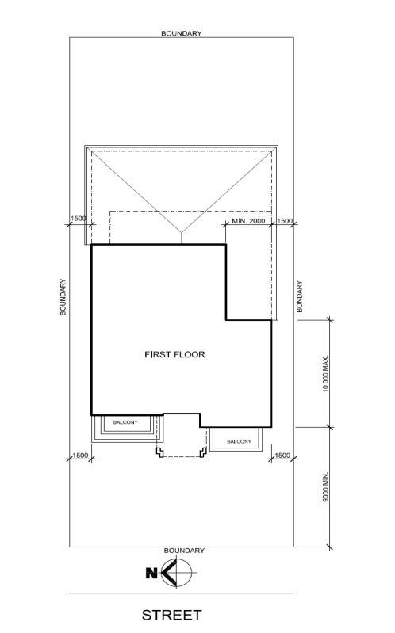
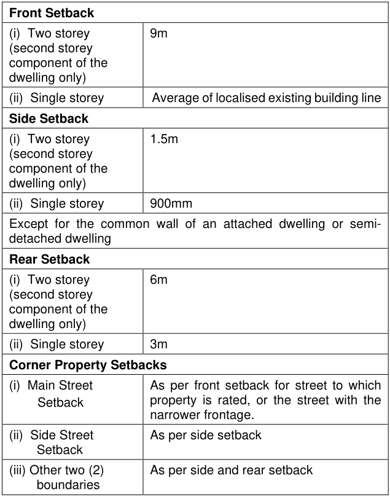

#### 4.5.2 Development Controls Building Appearance Overview

These Building Appearance controls apply only to streets and sites identified on the map in Section 8.2 titled Streets and Sites Subject to Building Appearance and Streetscape Provisions. These streets and sites have been recognised as having a high quality building appearance which should be maintained.

The appearance of single dwellings must be of a high standard to ensure that the character and visual cohesiveness of Burwood’s residential areas are not diminished. Alterations to the façade of existing houses can seriously disrupt the unity of a group of single dwellings and detract from their existing character. This section encourages the use of suitable materials, sympathetic design and appropriate building practices to maintain and enhance the visual character of Burwood’s residential buildings.

#### Objectives

O1 To ensure that new building works achieve a level of high quality design and are compatible with the character of Burwood’s residential areas.

4.5 Dwelling Houses, Attached Dwellings, Semi-Detached Dwellings, Ancillary Structures

O2 To maintain or enhance the quality and identity of development in the areas identified in the map in Section 8.2.

#### Provisions

Design

P1 The design of the single dwelling must aim to match or compliment the best design and detailing of development in the area, as well as, be of high architectural quality.

P2 Care must be given to the design of building forms and to all elevations, roof forms, windows, door openings and building features generally to ensure that the single dwelling is compatible with and complementary to its neighbours and the streetscape.

P3 Building heights must relate to the general character of the houses in the immediate locality and in the street.

P4 Overall massing of building volumes must be articulated or modulated to avoid a bulky appearance. Articulation must be reflected in the building and roof forms.

P5 Wide and/or long elevations must be treated to provide for visual relief in the form of setbacks, recesses and articulations.

P6 The front entry of the single dwelling must be clearly visible and obvious from the street. An exception to this provision is side entrances to Californian Bungalow and Interwar designs.

P7 Where there is a side entrance, it must be clearly identified by design and detailing such as paths, planting, fencing or side porches.

Materials, Workmanship and Finishes

P8 Materials and workmanship must be of high quality and compatible with the style of the single dwelling and with the best of surrounding development.

P9 Appropriate materials and finishes must complement the architectural style of the single dwelling.

P10 Samples of finished surface materials such as bricks, tiles, ridge capping, windows, doors and a schedule of paint colours must be submitted to Council as part of the Development Application.

P11 An orderly pattern of door and window treatment is required to compliment the style of the single dwelling. Window and door openings must be finished with appropriate lintels and sills. Window panels must be of vertical proportions and must be set in solid reveals and provide for consistency in appearance.

Building Elements

P12 Ancillary structures such as garages, carports and outbuildings must be designed to reflect the style of the single dwelling in relation to height, roof form, architecture, materials and the like. These should conform to relevant DCP controls and compliment the character of the residential area.

4.5 Dwelling Houses, Attached Dwellings, Semi-Detached Dwellings, Ancillary Structures

P13 Window treatments such as hoods, bay window design and/or timber framing in appropriate situations may be required to enhance the building appearance.

P14 The location or size of verandahs and balconies adjacent to garden areas and rooms within the house must be carefully designed and take into consideration the orientation for sun/shade and privacy for surrounding properties.

P15 Balconies and first floor verandahs must be of modest dimensions so as not to facilitate excessive use and impact upon the amenity and privacy of adjoining premises.

P16 External stairways are not permitted to the first floor level of the single dwelling or to balconies and first floor verandahs.

#### Streetscape Overview

This section applies only to streets and sites identified on the map in Section 8.2, titled Streets and Sites Subject to Building Appearance and Streetscape Provisions. These streets and sites have been recognised as having high quality streetscapes which should be maintained.

The streetscape includes both public domain spaces such as the street itself and the adjoining Council owned nature strip, as well as the front gardens and front building facades of each single dwelling within the street. Since the streetscape is about the interface between the private and public domain, every new development will affect the overall picture or character of an area. Whenever a new single dwelling or major alteration or addition is planned, it must respect and contribute to the streetscape and must not intrude upon or degrade the streetscape. Council’s assessment of DAs must evaluate the impact of the proposal on streetscape character.

#### Objectives

O1 To ensure that any new single dwelling or alteration to an existing single dwelling is compatible with and complements adjacent and nearby single dwellings in the street.

O2 To ensure that any new building work should positively contribute to the character of the streetscape and the locality.

#### Provisions

Site Planning and Design

P1 Single dwelling design must preserve existing characteristics of neighbouring houses and enhance the existing built form and streetscape values. New single dwellings must be of similar scale, form, bulk, placement and character to adjoining and nearby single dwellings in the street.

P2 The building line must be consistent with the adjacent single dwellings.

P3 Building height at the street frontage must not exceed the height and scale of adjoining development.

P4 Roof design, materials and detailing must be complementary to the streetscape character.

4.5 Dwelling Houses, Attached Dwellings, Semi-Detached Dwellings, Ancillary Structures

Major Alterations and New Single Dwellings

P5 New attached dwellings and semi-detached dwellings will generally not be permitted on land subject to the Building Appearance and Streetscape provisions, nor within heritage conservation areas, unless the attached or semi-detached form can be established as the predominant building form in the existing locality, and the design of the new structures is sympathetic to those existing structures.

P6 The design of major alterations must retain characteristic features prevalent in houses in the street. For example, design features such as a verandah, front gable, window awning, bay window, face brickwork or stone details should be retained or re-instated to retain and reinforce the prevailing streetscape character.

P7 The design of new single dwellings or alterations must incorporate characteristic features prevalent in houses in the street. For example, design features such as verandah, bay window, gable or main entry must be sympathetic and contribute to the prevailing streetscape character.

Two Storey Development

P8 A full two storey single dwelling would not be considered appropriate where surrounding single dwellings are mostly single storey. However, a part two storey single dwelling may be considered if the first floor is setback a minimum of 9m behind the front building line of the ground floor and located behind the main roof form of the building.

P9 To better integrate a new first floor level into a single storey area, its height and bulk can be kept to a minimum by reducing the floor to ceiling heights, together with the use of raked ceilings and attic type rooms with suitably proportioned dormer windows, where appropriate. The style of dormer windows should be compatible with the style of the house.

Gardens, Landscaping and Fences

P10 Front and side gardens, driveway entries and paths must use similar materials and methods to reinforce existing streetscape character. Planting and landscaping methods should follow existing patterns of development to reinforce the contribution of front and side gardens to the prevailing character of the streetscape.

P11 Front and side return fences must be of similar height, material and style to be in character and scale with existing fences or those of adjoining houses and in the street generally and in conformity with the Front and Side Fences section of this DCP Part.

Location of Vehicle Access, Garaging and Car Parking

P12 Where there is suitable side access for new garages and outbuildings they should be located to the rear of the property.

P13 New carports may be located along a side driveway providing these are setback from the building frontage and back from any front or side verandah.

P14 Garage door openings including intermediate piers must not exceed 40% of the entire width of the front elevation of the single dwelling.

P15 Any paved car parking spaces and carport structures must be located behind the front building line. Access driveways are not precluded.

4.5 Dwelling Houses, Attached Dwellings, Semi-Detached Dwellings, Ancillary Structures

P16 New driveways, paved turning areas and paths visible from the street must not dominate the front garden or impact on the streetscape values. Paving materials must be compatible with general streetscape character in terms of materials, colour, texture and extent.

#### Advisory Note:

Further provisions relating to vehicle parking, garages and carports in respect to heritage items and properties in a heritage conservation area are to be found in Section 4.7.

#### Sunlight Overview

Sunlight is an important component of residential amenity as it enhances people’s sense of wellbeing, has a demonstrated psychological value and promotes the growth of gardens and plants. The sun can also provide thermal benefits and solar energy for generation of hot water and electricity. It is imperative that living spaces, structures, walls and roofs have maximum access to sunlight.

#### Objectives

O1 To ensure that new development allows adequate sunlight.

O2 To ensure that new development minimises loss of winter sun on adjoining premises.

#### Provisions

P1 All building work must minimise overshadowing to adjoining properties, particularly to the south.

P2 Two storey single dwellings must not eliminate solar access on adjacent smaller dwellings.

P3 The street configuration of certain lots in the Burwood LGA does not allow shadowing to be prevented. There will be some instances where dwellings may lose sunlight on narrow lots with an east to west axis this is notwithstanding that Council makes every effort to ensure reasonable solar access.

P4 Maximum use must be made of north facing areas for windows, outdoor recreation and clothes drying, etc.

P5 During the summer season, the sun is not to cause overheating in living areas of the single dwelling. This overheating can be reduced through effective methods such as insulation, reflective barriers and shading.

P6 The floor to ceiling height for the first floor level of the proposed single dwelling is not to exceed 2.6m, and the ground floor level is not to exceed 2.7m. However, the floor to ceiling height for the first floor level is required to be 2.4m in respect to a single dwelling in a Conservation Area or in respect to additions to a heritage item.

P7 Building floor levels must not be raised, where there is a slope to the site. Building heights are to be minimised by cutting of a site rather than filling.

P8 The southern elevation of the first floor building on the minimum setback is not to exceed 10m in length. Council will permit further extension if the wall is inset a further 2 metres as shown in Figure 92.

4.5 Dwelling Houses, Attached Dwellings, Semi-Detached Dwellings, Ancillary Structures

> [Picture on page 39: a picture, saved as a picture (images/section-04-development-in-residential-areas-page-39-2.gif, 150 dpi).]

#### Figure 92. Setbacks to Minimise Overshadowing

#### Privacy Overview

Private open spaces and living areas of adjacent dwellings should be protected from overlooking. Privacy refers to both visual and acoustic privacy. The design of a single dwelling should take into consideration the visual privacy of neighbours. The design considerations include fencing, windows and private open space as well as siting and internal layout of single dwellings.

#### Objective

O1 To maintain visual and acoustic privacy for adjacent and nearby residents.

#### Provisions

P1 Detailed site and building design elements should be incorporated to increase privacy without compromising access to natural light and air. Design detailing may include:

(i) Solid or semi-solid balustrades to balconies

(ii)  Offset windows of dwellings

(iii)  Recessed balconies and/or vertical fins

4.5 Dwelling Houses, Attached Dwellings, Semi-Detached Dwellings, Ancillary Structures

(iv)  Louvres or screen panels to windows and/or balconies to minimise overlooking and maintain privacy between living areas and open recreation areas

(v)  Fencing

(vi) Vegetation as a screen between spaces

(vii)   Pergolas or shading devices to limit overlooking

P2 Living areas, including studies, at the first floor must have raised sill heights and/or translucent glazing of windows to minimise loss of privacy to adjoining single dwellings.

P3 Translucent or opaque windows must be provided to all bathrooms, en-suites, water closets (i.e. toilet), and stairwells.

P4 Building layouts must be designed in relation to window placement, sill heights and doors to maximise privacy and minimise noise effects.

P5 To provide sufficient privacy there must be adequate building separation.

Balconies

P6 Balconies are not to be located at first floor level where they overlook neighbour’s outdoor living areas, unless adequate screening is implemented.

P7 Balconies are not permitted on the side elevation, with the exception of single dwellings located on corner blocks, i.e. the elevation facing the secondary street frontage.

P8 First floor balconies will not be permitted off living areas (bedroom access only) and must be of minimal dimensions. These balconies must not exceed a maximum width of 1.5 metres.

#### Height Overview

The height of the single dwelling has a bearing on the visual and physical bulk and scale of the building. The height of the single dwelling should maintain consistency with the majority of the single dwellings in the street.

#### Objective

O1 To ensure that new single dwellings or alterations to existing single dwellings are in scale with and maintain the character of existing development in the street.

#### Provisions

P1 Single dwellings must not exceed 8.5 metres in height from the natural ground level to the ridge as measured vertically at any point.

P2 Notwithstanding P1 above, in particular circumstances there may be exceptions granted for steeper pitched roofs that do not detract from the aesthetics of the single dwelling.

P3 Single dwellings must not exceed two stories in height above the natural ground level. However, consideration may be given to a basement where such area has a ceiling height not exceeding 2.3 metres from the underside of the edge beam and is below existing ground level as described in P5 below.

4.5 Dwelling Houses, Attached Dwellings, Semi-Detached Dwellings, Ancillary Structures

P4 The basement area must not be used as a habitable room.

P5 Basement areas must not exceed existing natural ground level by more than 750mm when measured to the top of the ground floor slab above the existing ground level.

P6 The basement wall must be designed so as to form an integral part of the building and not look like a basement wall from the external elevation.

P7 The basement shall be wholly within the footprint of the dwelling above.

P8 The floor to ceiling height of the first floor level is not to exceed 2.6 metres to minimise overshadowing and excessive height.

P9 The floor to ceiling height of the ground level of new development is not to exceed 2.7 metres.

P10 The ceiling height for attic rooms, rooms with a sloping ceiling or projections below ceiling lines, non-habitable rooms or the like must not interfere with the room or space’s intended purpose.

P11 The floor to ceiling height of rooms must satisfy the requirements of the Building Code of Australia Housing Provisions Part 3.8.2.2 “Ceiling Height”, and must ensure that the room or space is used for its intended purpose, and that the level of fire safety, health and amenity is not reduced.

P12 Building heights must relate to the general character of houses in the immediate locality and in the street.

#### Storage

P13 Storage areas in roofs of single dwellings are permitted as long as there are no permanent stairs and no dormer windows within the roof so as to ensure it does not appear as a habitable room. The roof may contain ventilated skylight windows.

#### Setbacks Overview

Setbacks define the overall footprint of a building and the outer walls in relation to the front, side and rear boundaries. Appropriate street setback controls can contribute to the public domain by enhancing the streetscape character and the continuity of street facades.

#### Objectives

O1 To ensure that new single dwellings or alterations to existing single dwellings are of consistent scale and maintain the character of existing development in the street.

#### Provisions

P1 Single dwellings must comply with the minimum setback requirements as set out in the table below:

4.5 Dwelling Houses, Attached Dwellings, Semi-Detached Dwellings, Ancillary Structures

#### Table 3. Setback Requirements for Single Dwelling Houses

> [Picture on page 42: a map, saved as a picture (images/section-04-development-in-residential-areas-page-42-3.gif, 150 dpi); the street names and other small labels are on the picture.]
> Labels printed on the map (copied from the PDF, in no particular order):
> Front Setback · 9m · (i)  Two storey · (second storey · component of the · dwelling only) · (ii)  Single storey Average of localised existing building line · Side Setback · 1.5m · (i)  Two storey · (second storey · component of the · dwelling only) · (ii)  Single storey 900mm · Except for the common wall of an attached dwelling or semi- · detached dwelling · Rear Setback · 6m · (i)  Two storey · (second storey · component of the · dwelling only) · (ii)  Single storey 3m · Corner Property Setbacks · (i)  Main Street · Setback · As per front setback for street to which · property is rated, or the street with the · narrower frontage. · (ii)  Side Street As per side setback · Setback · (iii) Other two (2) As per side and rear setback · boundaries

P2 All single dwellings must provide an eave overhang. The minimum width of the eave including the gutter must be 450mm.

P3 Council may consider a variation to reduce the eave heights, provided that there is no increased overshadowing.

P4 Single dwellings must provide setbacks that are consistent with the existing setback.

P5 A reduced setback which utilises existing foundations may be acceptable for single storey dwellings.

P6 An increased front setback may be required for new building works that are bulkier than the existing single dwellings on the adjoining sites.

P7 The maximum length of a first floor elevation of a single dwelling is 10m along its southern elevation where it is provided as one continuous and uniform elevation (Refer to Figure 92).

P8 Where a first floor elevation is greater than 10m along the southern elevation, that part of the first floor elevation greater than 10m must be setback a further 2m from the side building line (Refer to Figure 92).

4.5 Dwelling Houses, Attached Dwellings, Semi-Detached Dwellings, Ancillary Structures

P9 Encroachments of up to 1.5m into the 9m front setback of the first floor level of a single dwelling may be approved for architectural elements such as bay windows, balconies, decorative timber and brick subject to the following:

(i) Minimal adverse impact on surrounding properties in terms of overshadowing and privacy

(ii) High quality architectural design

(iii) Variation to the front setback not to exceed 50% of the width and height of the first floor front elevation

P10 Ancillary structures such as garages, sheds and the like, that are attached to the dwelling on a site must be setback 900mm from the respective side boundary. Exceptions may be given for open structures such as carports, awnings and pergolas, subject to compliance with the Building Code of Australia requirements.

#### Floor Space Ratio and Built Area Overview

Floor Space Ratio (FSR) and Built Area provisions aim to facilitate an acceptable bulk and scale of development. It is important to regulate the total size of single dwellings relative to allotment size in order to prevent over development.

#### Objectives

O1 To control the building bulk of single dwellings and additions.

O2 To prevent over development occurring in the Burwood LGA.

O3 To provide for a site layout that gives usable open area and a building form that is compatible in size with the surrounding areas.

#### Provisions

P1 The maximum Floor Space Ratio (FSR) is set out in the Floor Space Ratio Map. FSR and its calculation are defined in the BLEP 2012.

#### Advisory Note:

For calculating the Floor Space Ratio, it is important to consult the definition contained in clause 4.5(2) of the BLEP 2012, together with the definition of Gross Floor Area in the BLEP 2012 Dictionary. It should be noted that the calculation is taken from the internal face of walls and includes all buildings within a site.

P2 The maximum Built Area is 67%.

Built Area is determined to be the total floor area of all buildings relative to the area of the allotment of land, expressed as a percentage. The calculation of Built Area shall be taken from the external face of walls (i.e. includes wall thickness) and includes the area of each floor or storey balconies, verandahs and the like, whether covered or uncovered, open or enclosed garages, carports and covered parking (except basement car parking) and outbuildings. Built Area excludes outdoor swimming pools, paths and exterior driveways.

P3 Irrespective of the allotment size, Council does not generally favour single dwellings exceeding 450 sqm Built Area. Applicants should submit written justification in support of larger dwellings. Buildings above this size will generally only be allowed where the allotment size and the character of the existing development in the area so warrants.

4.5 Dwelling Houses, Attached Dwellings, Semi-Detached Dwellings, Ancillary Structures

P4 In an R1 and R3 zone, a maximum Built Area of over 67% may be considered having regard to the predominant land uses in the vicinity, their scale, the streetscape and the impact of the proposal on surrounding development.

#### Landscaped Areas Overview

The aesthetic benefits of landscaping are well recognised and can be seen every day in gardens. Trees and plants add life, colour and variety. Landscaping can provide shade from the hot summer sun, screen unsightly views, protect us from strong winds, reduce both air and noise pollution, provide visual privacy, soften buildings or structures and attract native birds into a garden. Appropriate plantings on allotments can enhance the overall character of the street and add value to your property.

#### Objectives

O1 To ensure functional private outdoor spaces are provided for residents.

O2 To encourage the preservation and integration of existing trees and natural features into the design of new development.

O3 To screen and soften the impact of buildings and improve the view along the street.

O4 To maximise winter sun and minimise summer sun.

O5 To help minimise stormwater runoff.

#### Provisions

P1 A minimum 30% of the front setback (i.e. front yard) is to consist of soft landscaping.

P2 Rear yards will not be permitted to be dominated by hard landscaping. A minimum of 70% of the rear yard shall be soft landscaping.

P3 Paved or hard surfaces shall incorporate appropriate drainage to control water runoff and avoid nuisance to adjoining properties. Paving materials must be selected to blend with both building materials and plantings.

P4 Where practical, new structures must be positioned to provide for the retention and protection of existing significant trees and other natural features. Where removal of existing trees is proposed, details of suitable replacement trees are to be provided. These must be replaced at a rate of one new tree for each tree removed, or as otherwise specified by Council’s Landscape Code.

P5 Cutting and filling is to be minimised as far as practicable. Fill material must be clean fill only and placed in such a manner so as not to disturb existing trees that are to be retained. The maximum permitted depth of fill on a site is 500mm.

P6 All Development Applications for new dwellings must be accompanied with a Landscape Plan as part of the application submission.

P7 All planting beds and mounds must be mulched to a depth of 50-75mm using coarse textured mulch.

4.5 Dwelling Houses, Attached Dwellings, Semi-Detached Dwellings, Ancillary Structures

P8 Plants that are declared priority under the Biosecurity  Act 2015 must be identified and removed.

P9 The siting of new buildings, structures, driveways and other hard surface areas must take into consideration impacts on the root zone of existing trees.

P10 Tree species must be considered that provide shading in summer and solar access in winter.

P11 Plant species should be chosen which have low water requirements.

P12 New plantings must be complementary to the existing streetscape.

P13 Aboveground rainwater tanks must not be installed in the front setback. Consideration will be given to underground rainwater tanks in the front setback.

#### Utility Services Objective

O1 To ensure that single dwellings are designed with water, sewerage and electricity requirements in mind.

#### Provisions

P1 All water and sewerage pipes and duct work must not be visible from a public place and must meet Sydney Water’s requirements.

P2 Electricity power poles placed within the front yard of the house must be treated in colours that match the existing single dwelling and be to Council’s satisfaction.

#### Drainage Objective

O1 To ensure that new development does not result in flooding issues on the site or adjacent properties.

#### Provisions

P1 All drainage works must comply with Council’s Stormwater Management Code.

P2 Existing natural overland stormwater flow paths must not be diverted by fencing, retaining walls, buildings, paved areas or any other form of construction.

P3 New hard paved surfaces must be kept to a minimum to prevent stormwater runoff.

P4 Stormwater runoff from roofs, hard surfaces, swimming pools and the like must be collected, piped and drained to the kerb or an inter-allotment drainage system. Charged lines are permitted, however these must be designed by a practicing Hydraulic Engineer.

P5 Pits and pumps are generally not permitted, except within basement garages.

P6 Absorption trenches are generally not permitted.

4.5 Dwelling Houses, Attached Dwellings, Semi-Detached Dwellings, Ancillary Structures

P7 Ground floor levels must be sufficiently elevated so as not to be subject to flooding.

P8 Soft landscaping and pervious surfaces must be maximised on the site.

P9 A stormwater concept plan is required to be submitted to Council in accordance with Council’s Stormwater Management Code.

#### Swimming Pools Objective

O1 To ensure that pools are properly located and secured in the interest of safety.

#### Provisions

P1 The private open space must be useable and reasonably sized to incorporate a swimming pool. The pool area must not utilise the remaining private open space.

P2 Pool equipment must be located so as to minimise excessive noise impacts.

P3 The siting of the pool must minimise noise impacts and water splash on neighbouring properties.

P4 The landscape design must provide summer shade for pool users.

P5 The swimming pool area shall be fenced in conformity with the Swimming Pools Act 1992, the Building Code of Australia (BCA) and Australian Standards AS 1926-2007 Part 1 and 2 – Swimming Pool Safety.

P6 Swimming pool fencing shall separate the pool from the dwelling, outbuildings, structures and any adjoining premises or public place.

P7 A minimum setback of 1m must be provided from the water edge of the pool to the boundary.

P8 Pools are not permitted in the front yard of a property.

P9 No ancillary or other structures are permitted within the fenced pool area, except for diving boards or pool filter equipment.

#### Fire Safety Objective

O1 To ensure that all new building work provides for an acceptable level of safety for residents in case of fire.

#### Provisions

P1 External walls of single dwellings and other structures must be of fire resistant construction, and comply with the relevant provisions of the Building Code of Australia.

P2 Approved smoke alarms must be installed in accordance with the Building Code of Australia and Australian Standard AS 3786-1993 - Smoke Alarms.

4.5 Dwelling Houses, Attached Dwellings, Semi-Detached Dwellings, Ancillary Structures

P3 Effective setback and/or protection of structures from fire source features must be in accordance with the Building Code of Australia.

#### Advisory Note:

Please refer to Building Code of Australia for further information on fire safety.

#### Demolition Objective

O1 To ensure that the demolition of structures is carried out in an effective manner without affecting the health and amenity of the surrounding residents.

#### Provisions

P1 All demolition must be carried out in accordance with Australian Standard AS 2601- 2001- The Demolition of Structures.

P2 All building materials containing asbestos must be carefully handled and removed from the site in accordance with WorkCover requirements.

P3 To minimise dust and debris that cause an unnecessary hazard and/or damage to surrounding properties, appropriate protective measures must be taken.

P4 To minimise sediment movement and water pollution due to surface run off, protective environmental site management measures must be employed on site.

P5 To minimise damage to street trees, footpaths, kerbing and road pavements, protective measures must be employed.

#### Earthworks Objectives

O1 To ensure that site works are safe and environmentally sound.

O2 To ensure that adjoining residents are not detrimentally affected by the removal of soil or rock.

#### Provisions

P1 Adequate sedimentation control measures must be provided around sites to prevent polluted surface run off reaching water course or adjoining land, prior to the commencement of any work.

P2 To prevent earthworks from becoming dangerous to life or property, excavation must be adequately shored and guarded.

P3 Batters or underpinning of excavation is required to protect structures on adjacent properties from ground surface movement.

P4 The details of excavation or filling of land must be included in the Development Application.

P5 A dilapidation survey may be required to be carried out for excavations.

4.5 Dwelling Houses, Attached Dwellings, Semi-Detached Dwellings, Ancillary Structures

P6 In excavated areas after rain periods, seepage, or the ponding of water must be collected and disposed of in an appropriate manner.

P7 The maximum permitted depth of fill on a site is 500mm. Cutting and filling is to be minimised as far as practicable. Fill materials must be clean fill only and placed in such a manner so as not to disturb existing trees that are to be retained.
