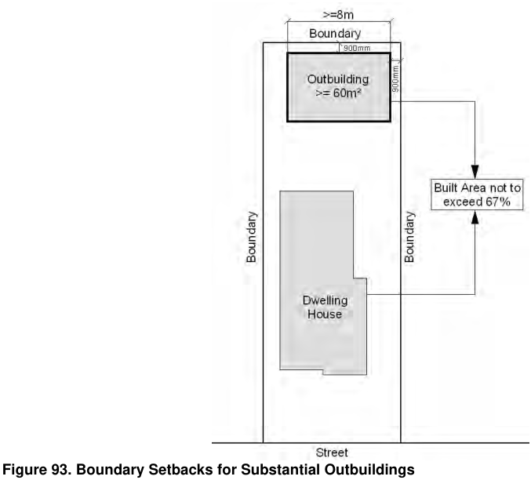

#### 4.5.3.3 Other Ancillary Structures General Objectives

O1 To recognise the needs of residents to erect ancillary structures.

O2 To minimise the size, bulk and scale of ancillary structures.

4.5 Dwelling Houses, Attached Dwellings, Semi-Detached Dwellings, Ancillary Structures

O3 To provide clear provisions for other ancillary structures that do not include garages or carports.

#### Provisions

P1 Any garage or outbuilding with a floor area of 60 sqaurre metres  more, or a continuous wall length of 8 metres or more, must be setback a minimum of 900mm from all side and rear boundaries. This control seeks to limit the impact of substantial outbuildings on adjoining properties, and discourages outbuildings which are in close proximity to multiple boundaries. This control will also be applied to any new work where the combined floor area of all outbuildings exceeds 60 square metres.

> [Picture on page 52: a picture, saved as a picture (images/section-04-development-in-residential-areas-page-52-11.gif, 150 dpi).]

#### Figure 93. Boundary Setbacks for Substantial Outbuildings

P2 Where multiple ancillary structures are proposed upon a property, combining these uses within a single structure is encouraged.

P3 The controls applying to garages will generally be applied to other ancillary structures, such as sheds, studios, cabanas and the like.

P4 Amenities such as a shower, toilet or hand wash basin will only be permitted to be installed within an outbuilding under specific circumstances, and at Council’s discretion. Access to these amenities shall be by an externally-accessed door (e.g. opening onto the rear yard), as opposed to being accessed from the interior space, such to discourage use of the structure as a separate dwelling.
