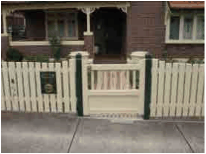
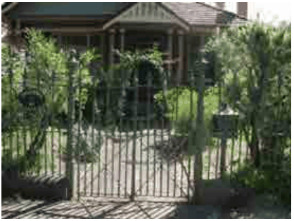
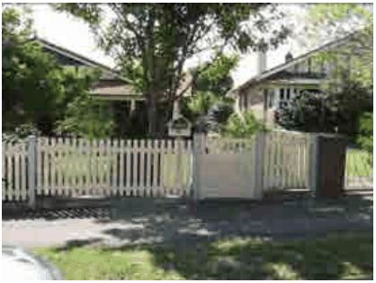

### 4.7 Heritage in Residential Precincts

#### Advisory Note:

The provisions of the Dividing Fences Act are to be observed in regard to fences, on the dividing boundary between two properties.

Lych Gates

P21 Elaborate lych gates are uncommon features in Burwood and will generally only be permitted where it can be demonstrated that the Lych gate was a pre-existing feature of the property, and where it is compatible with the character of the dwelling house or locality.

#### Victorian Cast Iron Pickets and Gate

> [Picture on page 73: a picture, saved as a picture (images/section-04-development-in-residential-areas-page-73-11.gif, 150 dpi).]

#### Federation Bungalow Timber Palings and Gate

#### Inter-War Bungalow Timber Paling Fence and Gate

#### Examples of Fence and Gate Styles

> [Picture on page 73: a picture, saved as a picture (images/section-04-development-in-residential-areas-page-73-15.gif, 150 dpi).]

> [Picture on page 73: a picture, saved as a picture (images/section-04-development-in-residential-areas-page-73-16.gif, 150 dpi).]
