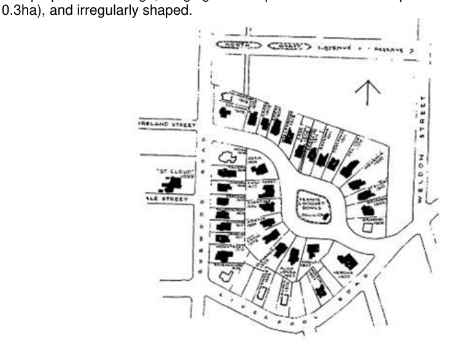

### 4.8 Special Residential Precincts

### 4.8 Special Residential Precincts

#### 4.8.1 Appian Way Overview

The original Hoskins’ Estate dating from the early 1900’s consisted of 39 allotments, with 36 houses fronting Burwood Road, Appian Way and Liverpool Road plus a recreation reserve. The properties are large, ranging from a quarter acre to three-quarters of an acre, (0.1ha to 0.3ha), and irregularly shaped.

> [Picture on page 74: a picture, saved as a picture (images/section-04-development-in-residential-areas-page-74-9.gif, 150 dpi).]

#### Figure 94. Original Plan Hoskins Estate

The Conservation Area currently comprises 41 houses, 31 of which are reasonably intact, a recreation area consisting of three lawn tennis courts with a weatherboard pavilion, and landscape elements such as street trees and picket fences. Five houses (nos. 70-78 Liverpool Road, southern side) within the Conservation Area are not in the Hoskins Estate but in the Austinlee Estate and three houses of the original estate fronting Liverpool Road are not in the Conservation Area.

A more detailed assessment of the significance of the Appian Way Heritage Conservation Area may be found at Appendix 8.5.
