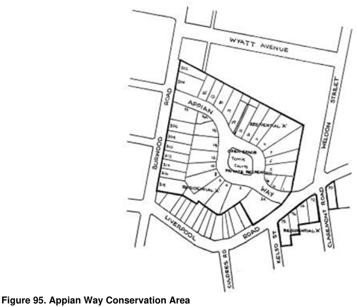

### 4.8 Special Residential Precincts

> [Picture on page 75: a picture, saved as a picture (images/section-04-development-in-residential-areas-page-75-2.gif, 150 dpi).]

#### Figure 95. Appian Way Conservation Area

#### Objectives

O1 To provide appropriate and consistent policy guidance for future development:

(a)  By ensuring permanent protection of the Conservation Area, including all existing structures, landscape features and relics, and the setting of the area.

(b)  Which will result in the long-term conservation and enhancement of the historic, architectural, landscape and streetscape elements which contribute to the distinctive character and unique environment of the Conservation Area.

O2  To conserve the heritage significance of the Conservation Area and its setting.

O3  To increase the awareness of persons using the BDCP about the significance of the Conservation Area and the role of development in that context.

O4  To conserve and/or enhance existing buildings, structures and works in the Conservation Area.

O5  To retain and/or reinstate the characteristic architectural, landscape and streetscape elements of the Conservation Area.

O6  To ensure that new development will safeguard the historic, cultural, social, architectural or aesthetic significance of the building, work or site as well as the streetscape of the area.

O7  To ensure new development is sympathetic to the particular building and/or the Conservation Area in terms of siting, form, massing, articulation and detail composition.

O8  To ensure that the proposed form of roof and details the style, size, proportion and position of openings of windows and doors the colours, textures, style, size and type of finish of materials to be used on the exterior of building are compatible with similar
