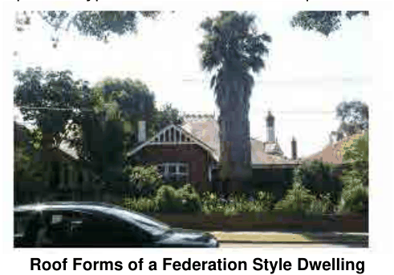

### 4.8 Special Residential Precincts

P7 Alterations and additions should be incorporated to complement the style of the existing building and its setting, and not detract from the original and/or existing relationship of the building or works to the street.

P8 Upper floor extensions should not interrupt the existing roof line. An original high-pitched roof suited to the building style may allow rooms at an attic level, with appropriately scaled dormer windows for light.

P9 Other forms of upper addition are generally out of character and/or given allotment size, prove to be overpowering and as such, are unacceptable.

Roof Details

P10 Roofs for Federation style dwellings should form one major (hipped) section with secondary gables and hips. Bungalow roofs are simpler in treatment. A-frame, mansard and Cape Cod type variations are not acceptable.

> [Picture on page 85: a picture, saved as a picture (images/section-04-development-in-residential-areas-page-85-14.gif, 150 dpi).]

#### Roof Forms of a Federation Style Dwelling

P11 Small suitably designed gables or gablets and other repeated elements should reflect the proportions, detailing and form of the main gable.

P12 The use of turrets, spires, domes and towers, and dormer windows are permitted, where appropriate, as they break the roof form and add individuality, and are useful to reinforce a change in floor plan, a corner, verandah or entry. These elements are not to dominate the contextual form or setting of the existing building,

P13 Additions and extensions should not to have a roof line which dominates the front and/or side elevations of the dwelling nor be out of scale with those in the conservation area.

P14 Roof additions should not dominate the presentation of the existing dwelling as viewed from the street and shall remain recessive, to be limited to appropriate roof elements which maintain the existing composition of the front façade.

P15 Extensions located to the rear of the dwelling should respect the form and balance of the existing rear part of the building and the layout of the garden, and should incorporate the use of a skillion or simple hip roof treatment, with a demonstrably lower ridge height compared to that of the ‘main’ roof section of the dwelling to appear subservient to the form and balance of the main roof.

P16 Upper floor extensions should be contained within the existing roof line, particularly with existing roof forms of a high pitch (30 to 35 degrees) required to accommodate a proposed attic level. Such roof additions will capture sunlight from appropriately scaled dormer windows.
