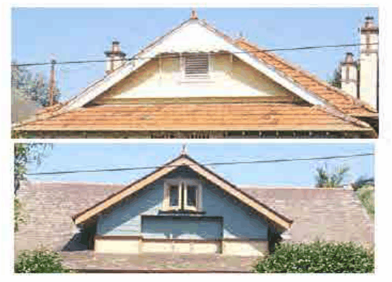

### 4.8 Special Residential Precincts

P17 Any lateral roof extension should be in a ‘corrugated iron’ clad skillion section or, if pitched, to have the ridge at a markedly lower level than that of the main existing roof form.

P18 Other forms of alterations and additions which do not satisfy Controls P10–P17 are considered to be generally out of character and unacceptable (other than skillion sections of dwellings or outbuildings).

P19 Roofs of all residential buildings should be finished with either slates or Marseilles terracotta orange tiles (unglazed), as appropriate, with roofs to be completed as a single entity. Patching of roof materials to be undertaken from rear to front and side elevations, with replacements occurring to the whole of the rear, as necessary to allow existing material to be recycled for use on the side and front roof slopes.

> [Picture on page 86: a picture, saved as a picture (images/section-04-development-in-residential-areas-page-86-13.gif, 150 dpi).]

#### Unglazed Terracotta Tiles with Marseilles Profile (above) or Slate Roof (below)

#### Advisory Note:

Repairs to slate roofs is a specialist’s job where colour, texture and material weight need special consideration, Patching with recycled materials may leave an undesirable “mottled” effect.

Roof Decoration Details

P20 Decoration and detail of new roofs should, where appropriate, be designed and detailed to match the design and details of the existing house or other contributory houses in the conservation area.

P21 The following list includes typical roof details:

Terracotta ridge cappings and ornaments (crests, finials) are appropriate for tile and slate roofs. Original gable ends may accommodate shingles (oiled or painted) or rendered brickwork, either stucco and roughcast patterns. Rafter ends to roof caves are to be exposed, but shall maintain a minimal overhang. Guttering shall be of half-round or ogee profile, with downpipes to be round in profile. Skillion roofs at the rear of dwellings should be clad in corrugated iron/Custom Orb.
