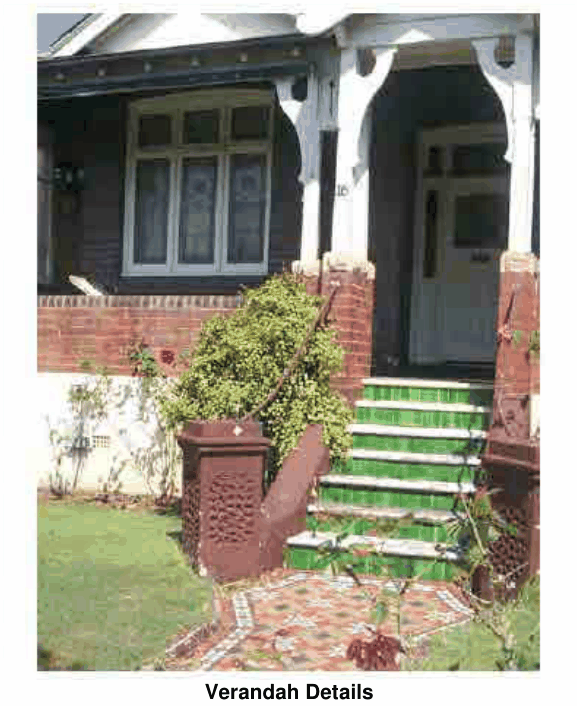

### 4.8 Special Residential Precincts

> [Picture on page 88: a picture, saved as a picture (images/section-04-development-in-residential-areas-page-88-2.gif, 150 dpi).]

#### Verandah Details

Façade Details

P28 The external wall finish of a dwelling should match that of the existing dwelling or be appropriate to that or original dwellings in the area and incorporate the following details:

smooth face brickwork, in red to brown, purplish rough cast and stonework under bay windows horizontal courses of darker brickwork and tuck pointing, to highlight façades and/or tuck-pointing and brick banding.

P29 Any bay window to the side elevation to a side street on a corner lot should be appropriately scaled, have windows of proper proportions, not exceed one in number and be preferably adjacent to a front or rear ‘wrap around’ verandah.

Window and Sunhood Details

P30 New windows for a dwelling are to match and complement original windows and shall incorporate the following details:

vertical modules, either single and grouped in banks divided only by timber sashes and mullions the proportions of an opening rectangular window shall generally be a third as wide as it is tall (for a single window), with banking in these proportions for larger openings and for bay windows window frames should be in wood and (or suitable wood lookalike construction) painted in colours to match originals. Stained woodwork is not suitable
