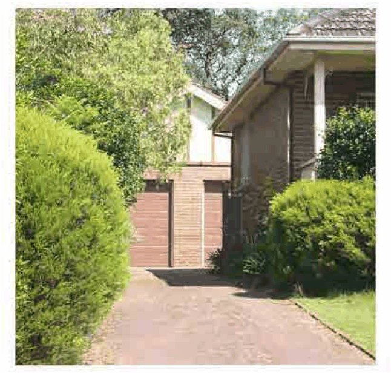

### 4.8 Special Residential Precincts

> [Picture on page 90: a picture, saved as a picture (images/section-04-development-in-residential-areas-page-90-2.gif, 150 dpi).]

#### Garages to be Located to the Rear of the Dwelling

P42 Driveway paving should reflect the garden setting of the existing dwelling and incorporate the use of period garden design elements, i.e. gravel finishes, informal paying, brick edging, etc.

P43 Garages and carports on corner sites should be located at the rear of the rear yard and should not be forward of the building line of the adjacent dwelling.

Fence and Gate Details

P44 The style and height of front and side return fencing should reflect the original details and characteristics within the Malvern Hill Estate, such as: timber picket low brick with or without metal pipes or wrought iron work low brick with stone capping and base post and rail with cyclone wire infill for side return fencing.

P45 Gates, letterboxes, lighting and other street furniture or site facilities, visible from the street are to be appropriately styled to reflect original details and characteristics relevant to the Malvern Hill Estate.

P46 Side fences (behind the building line, except for corner lots) and rear fences should be formed by up to 1.8m high wooden palings.

P47 Side return fences on corner properties should be of the same height and form (facing the side street) as the front fence up to a point towards the rear of the dwelling where the skillion section commences (or would normally commence).

P48   The rear section of the side fence on a corner site facing the side street should be 1.8m high paling fencing.
