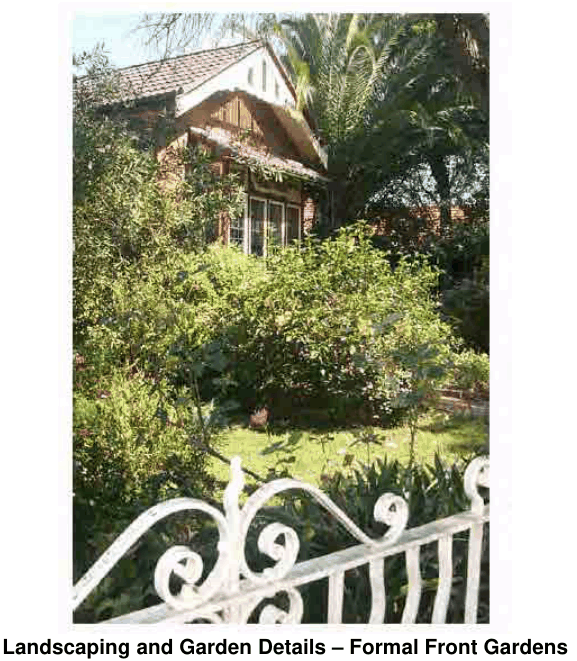

### 4.8 Special Residential Precincts

Landscaping/Gardens Details

P49 A formal design is appropriate for front and side gardens viewed from the street, with landscape plans to demonstrate:

well defined boundaries trimmed lawns (preferably buffalo or couch) edges and planting in neat beds shrubs and shade trees, as features, located to complement the setting of the dwelling house.

> [Picture on page 91: a picture, saved as a picture (images/section-04-development-in-residential-areas-page-91-10.gif, 150 dpi).]

#### Landscaping and Garden Details – Formal Front Gardens

P50 Pathways and flowerbeds may divide the lawn area.

P51 Rear gardens may be more informal and functional to individual use.

P52 A landscape plan should be provided where alterations or additions to existing garden layouts are proposed. New planting should correspond with details of original plant species and garden layouts typical of the period garden setting of the dwelling or, where more appropriate, the conservation area.

P53 Existing contributory trees, plants, garden layouts and garden features should be retained and incorporated within any development proposal.

Colours, External Finishes and Other Decoration Details

P54 A full colour scheme should be provided with the Development Application, with colours selected to correspond to paint types, shades and compositions which respect the period character of the existing building or work or, where more appropriate, the conservation area generally.
