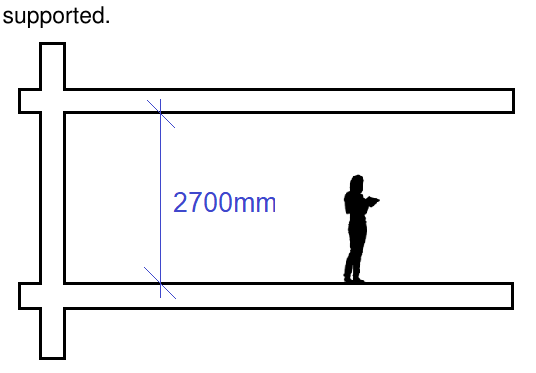

### 5.4 Boarding House and Co-Living Housing

(h)  how the bulk, mass, modulation, separation, setback and height of buildings have been addressed and whether they are appropriate in the context of existing and proposed buildings,

(i)  whether a high standard of ecologically sustainable design (including low-energy or passive design) will be achieved and overshadowing, wind effects and reflectivity will be minimised.

#### 5.4.4 Built form Design Objectives

O12. Establish the appropriate separation of the built form to the public domain and adjoining development.

O13. Ensure ceiling heights allow for sufficient daylight access and natural ventilation.

#### Provisions

P8. The main entrance of the boarding house or co-living housing development is to be provided within the street elevation to address the street. Side entrances will only be permitted on sites with a secondary frontage and only where they result in a cohesive resolution of the streetscape and do not adversely impact upon neighbouring properties.

P9. Boarding house and co-living housing developments must have a minimum floor to ceiling height of 2.7m for habitable rooms. Subterranean habitable rooms will not be supported.

> [Picture on page 18: a picture, saved as a picture (images/section-05-other-development-provisions-page-18-22.gif, 150 dpi).]

Figure 96. Minimum floor to ceiling heights for boarding house and co-living housing

P10. In the case of existing dwellings being converted into boarding house or co-living housing, existing floor to ceiling heights are to be maintained or be no less than 2.7m, whichever is greater. Contributory facade elements and the integrity of the dwelling’s structural framework are to be maintained.

P11. Any new boarding house and co-living housing developments in an R1 General Residential Zone shall provide a front setback that is equivalent to the predominant street setback or 6m, whichever is greater.
